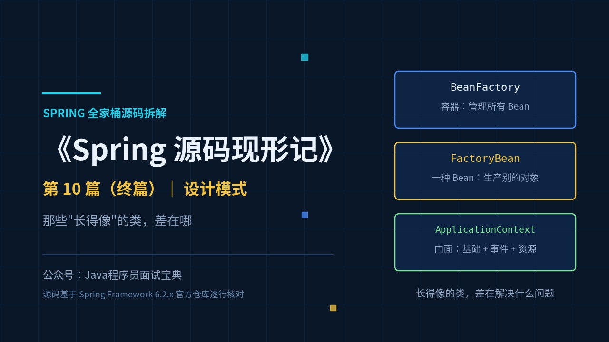
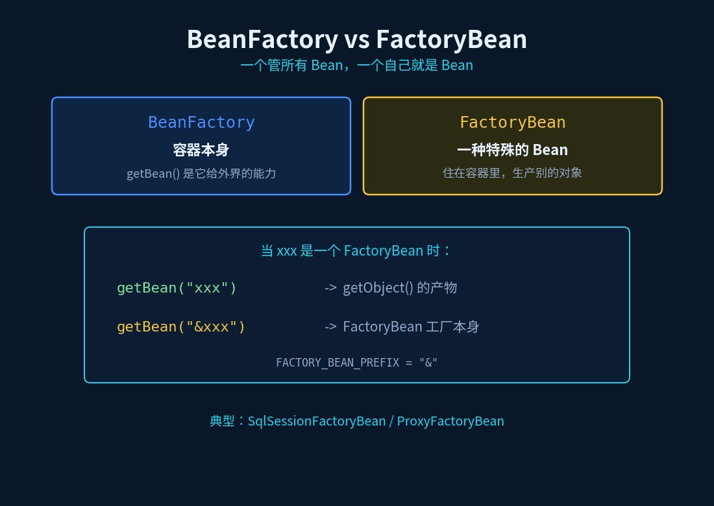
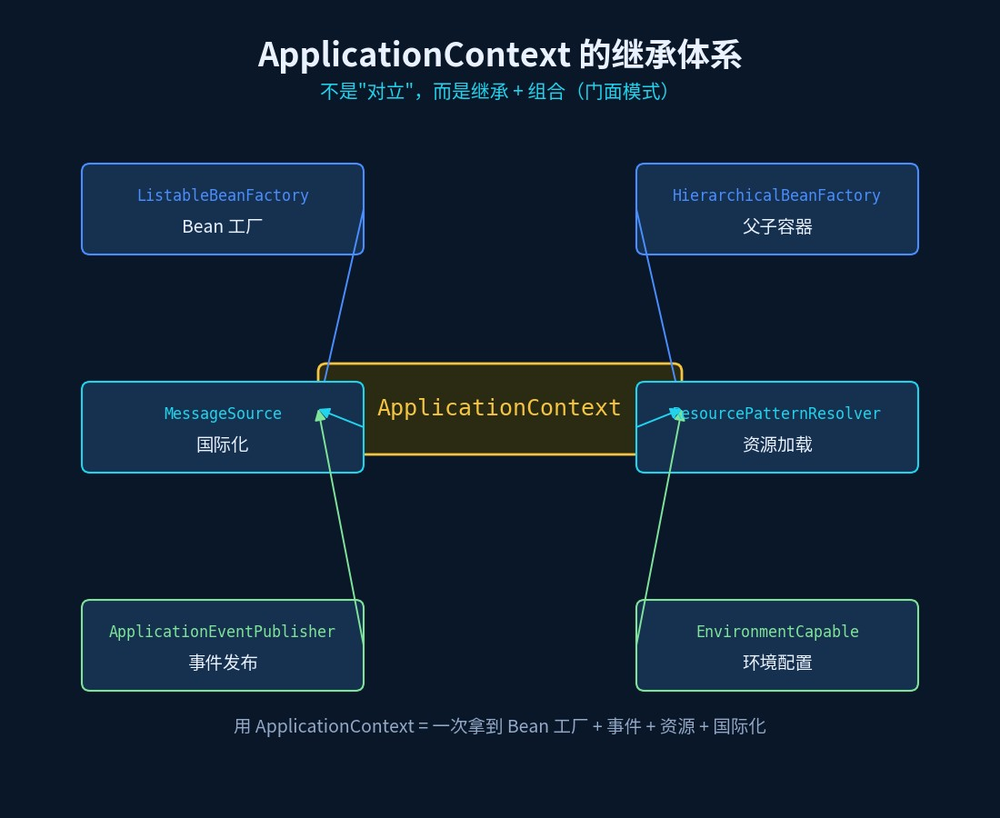
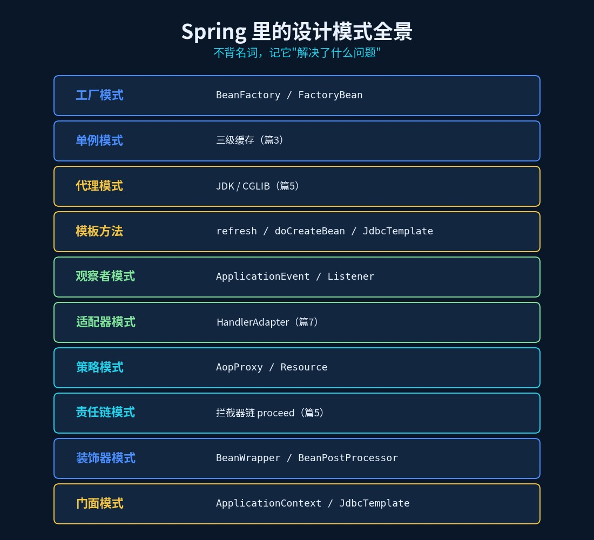
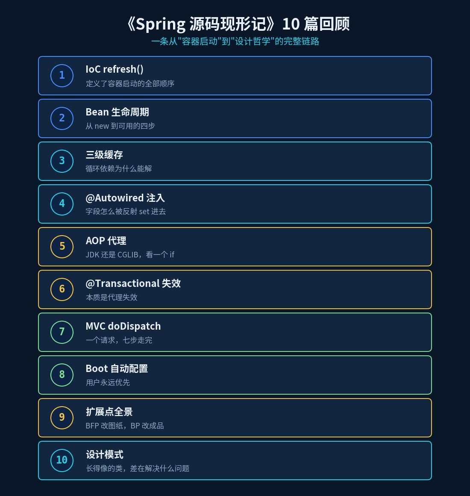

# Spring 里的设计模式：那些"长得像"的类，差在哪

> 《Spring 源码现形记》第 10 篇（终篇）｜ 源码基于 Spring Framework 6.2.x 分支



## 三道"灵魂拷问"，拉开高手和普通人的差距

面试官："Spring 里用了哪些设计模式？"

候选人："工厂模式、单例模式、代理模式……"（开始背）

面试官："停。那我问你三个问题，答完再背也不迟——"

1. **`BeanFactory` 和 `FactoryBean`，区别是什么？**
2. **`ApplicationContext` 和 `BeanFactory`，是什么关系？**
3. **`BeanFactoryPostProcessor` 和 `BeanPostProcessor`，差在哪？**

三道题全是"长得像的类"。答不出来，说明你把设计模式当名词背了——**而 Spring 的设计模式，从来不是"用了哪个模式"，而是"为什么这样设计"。**

这是本系列最后一篇。我们不挖单个类，而是回头看：**把这些"长得像"的类串起来，你就能看见 Spring 的设计哲学。**

## 一、`BeanFactory` vs `FactoryBean`：差一个词，差一个身份

这俩名字简直是"故意为难人"。一句话分清：

- **`BeanFactory`**：**容器本身**。它是"生产和管理 Bean 的工厂"——`getBean()` 是它给外界的能力。
- **`FactoryBean`**：**一种特殊的 Bean**。它是"一个用来生产别的对象的 Bean"——**它自己也住在容器里**。

看接口签名（6.2.x）：

```java
public interface FactoryBean<T> {
    @Nullable
    T getObject() throws Exception;      // 返回它"生产"出来的对象
    @Nullable
    Class<?> getObjectType();            // 它生产什么类型
    default boolean isSingleton() { return true; }
}
```

关键点在这里：**当你 `getBean("xxx")` 时，如果 `xxx` 是一个 `FactoryBean`，容器返回的是 `getObject()` 的结果，不是工厂本身。** 想要工厂本身，得加前缀 `&`（`BeanFactory.FACTORY_BEAN_PREFIX = "&"`）：

```java
Object product  = context.getBean("myFactoryBean");    // → getObject() 的产物
Object factory  = context.getBean("&myFactoryBean");   // → FactoryBean 实例本身
```

**典型应用**：MyBatis 的 `SqlSessionFactoryBean`、Spring 的 `ProxyFactoryBean`——都是"用 FactoryBean 把复杂对象的创建过程封装起来"。这就是**工厂模式**在 Spring 里最经典的一处落地。



## 二、`ApplicationContext` vs `BeanFactory`：基础版 vs 增强版

这组不是"对立"，而是"**继承 + 增强**"。看 `ApplicationContext` 的声明：

```java
public interface ApplicationContext extends EnvironmentCapable, ListableBeanFactory, HierarchicalBeanFactory,
        MessageSource, ApplicationEventPublisher, ResourcePatternResolver {
```

一眼看清它的"血脉"：

| 继承的接口 | 给容器加了什么能力 | 设计模式 |
|---|---|---|
| `ListableBeanFactory` / `HierarchicalBeanFactory` | Bean 工厂的基础能力 | 工厂模式 |
| `MessageSource` | 国际化消息 | — |
| `ApplicationEventPublisher` | 事件发布（观察者） | **观察者模式** |
| `ResourcePatternResolver` | 资源加载（`classpath:`） | 策略模式 |
| `EnvironmentCapable` | 环境 & 配置 | — |

所以那句"`BeanFactory` 是最底层容器，`ApplicationContext` 是它的超集"，本质是：**`ApplicationContext` 用"继承 + 组合"把一堆能力统一到一个门面（Facade）后面**。你用一个 `ApplicationContext`，等于一次拿到了 Bean 工厂 + 事件总线 + 资源加载器 + 国际化。

**这就是门面模式（Facade）**：对外只暴露一个统一入口，内部一堆子系统。



## 三、三组"长得像"的类，一张表说清

| 对比 | A（角色） | B（角色） | 一句话区别 |
|---|---|---|---|
| `BeanFactory` vs `FactoryBean` | 容器/工厂 | 一种 Bean | 一个管所有 Bean，一个自己就是 Bean |
| `BeanFactory` vs `ApplicationContext` | 基础容器 | 增强容器 | 后者 = 前者 + 事件 + 资源 + 国际化 |
| `BeanFactoryPostProcessor` vs `BeanPostProcessor` | 改"图纸" | 改"成品" | 前者一次，后者每个 Bean 一次（篇9） |

## 四、Spring 里的设计模式全景

把前九篇的源码串起来，你会发现 Spring 把设计模式用到了"教科书级"。挑最常考的几个：

| 设计模式 | Spring 里的体现 | 本系列哪一篇 |
|---|---|---|
| **工厂模式** | `BeanFactory` / `FactoryBean` | 本篇 |
| **单例模式** | `DefaultSingletonBeanRegistry` 三级缓存 | 篇3 |
| **原型模式** | `scope = prototype` | 篇2 |
| **代理模式** | JDK / CGLIB 动态代理 | 篇5 |
| **模板方法** | `AbstractApplicationContext.refresh()`、`doCreateBean`、`JdbcTemplate` | 篇1/篇2 |
| **观察者模式** | `ApplicationEvent` / `ApplicationListener` | 本篇 |
| **适配器模式** | `HandlerAdapter`（把各种 handler 统一成 `handle()`） | 篇7 |
| **策略模式** | `InstantiationStrategy`、`AopProxy`、`Resource` | 篇5 |
| **责任链模式** | 拦截器链 `proceed()`（一层套一层） | 篇5 |
| **装饰器模式** | `BeanWrapper`、`BeanPostProcessor` 包装 Bean | 篇2/篇9 |
| **门面模式** | `ApplicationContext`、`JdbcTemplate` | 本篇 |

**怎么记？** 别背名词，记"**它解决了什么问题**"：

- 对象**怎么造** → 工厂 / 建造者 / 原型；
- 对象**怎么复用一份** → 单例；
- 调用**怎么解耦** → 观察者 / 适配器 / 责任链；
- 行为**怎么增强** → 代理 / 装饰器；
- 流程**怎么复用** → 模板方法；
- 接口**怎么收口** → 门面。

以**观察者模式**为例，看 Spring 的实现：

```java
public interface ApplicationEventPublisher {
    void publishEvent(Object event);
}
```

`ApplicationContext` 继承它；内部 `AbstractApplicationEventMulticaster` 负责"事件 → 监听器"的派发：

```java
protected Collection<ApplicationListener<?>> getApplicationListeners(
        ApplicationEvent event, ResolvableType eventType, Class<?> sourceType) {
    // 按事件类型和源类型，找出匹配的监听器（带缓存）
}
```

**发布者不认识订阅者**——`publishEvent` 只管发，谁监听、监听什么类型，注册时决定。这就是 `@EventListener` 能"无侵入"接事件的底层。



## 五、回头看：这 10 篇串成了一条线

《Spring 源码现形记》到这里就完整了。10 篇合起来，是一条从"容器启动"到"设计哲学"的完整链路：

| 篇 | 主题 | 一句话收获 |
|---|---|---|
| 1 | IoC `refresh()` | 十几行方法，定义了容器启动的全部顺序 |
| 2 | Bean 生命周期 | 一个 Bean，从 new 到可用经过哪四步 |
| 3 | 三级缓存 | 循环依赖为什么能解，构造器注入为什么不能 |
| 4 | `@Autowired` 注入 | 字段是怎么被反射 set 进去的 |
| 5 | AOP 代理 | JDK 还是 CGLIB，看一个 if |
| 6 | `@Transactional` 失效 | 事务失效的本质，是代理失效 |
| 7 | Spring MVC `doDispatch` | 一个请求，七步走完 |
| 8 | Boot 自动配置 | 约定优于配置，但用户永远优先 |
| 9 | 扩展点全景 | BFP 改图纸，BP 改成品 |
| 10 | 设计模式 | 长得像的类，差在"解决什么问题" |

**如果只记一句话**：**Spring 的每一处"设计"，都是为了让"变化的部分"可以被替换。**

- 想换容器行为 → `BeanFactoryPostProcessor`；
- 想换 Bean 加工方式 → `BeanPostProcessor`；
- 想换代理策略 → `AopProxy`；
- 想换视图解析 → `ViewResolver`。

**这不是"用了哪些设计模式"，而是"留了哪些口子"。** ——这，就是这一整套源码读下来，最值钱的东西。



## 速查表

| 问题 | 答案 |
|---|---|
| `BeanFactory` vs `FactoryBean` | 容器 vs 一种 Bean；`&beanName` 取工厂本身 |
| `ApplicationContext` vs `BeanFactory` | 后者是基础容器，前者 = 基础 + 事件 + 资源 + 国际化（门面） |
| `@Autowired` 在哪注入 | `populateBean` 阶段，BPP 的 `postProcessProperties`（篇4） |
| AOP 代理何时生成 | BPP 的 `postProcessAfterInitialization`（篇5/篇9） |
| 循环依赖怎么解 | 三级缓存（篇3） |
| Boot 为什么"用户优先" | `@ConditionalOnMissingBean` + 自动配置后置处理（篇8） |
| Spring 设计理念 | 为"变化的部分"留可替换的口子 |

## 动手验证（10 分钟）

1. 写一个 `FactoryBean`，分别用 `getBean("xxx")` 和 `getBean("&xxx")` 拿对象，看类型差异；
2. 打印 `applicationContext instanceof BeanFactory`、`instanceof ApplicationEventPublisher`——体会"门面"；
3. 用 IDE 打开 `ApplicationContext` 的继承图（Ctrl+H），看它到底继承了哪些接口；
4. 写一个 `@EventListener`，随便发个自定义事件，看它被接住——体会观察者的"发布/订阅解耦"。

## 写在最后（系列终章）

十篇下来，你会发现：**面试官追问的从来不是"你背没背过"，而是"你看没看过"。**

那些源码里的方法名——`refresh`、`initializeBean`、`proceed`、`doDispatch`、`getAutoConfigurationEntry`——才是把零散知识点串成一张网的线。

《Spring 源码现形记》· 完。

（全系列 10 篇可在公众号合集内查看，按顺序读，效果最佳。）
