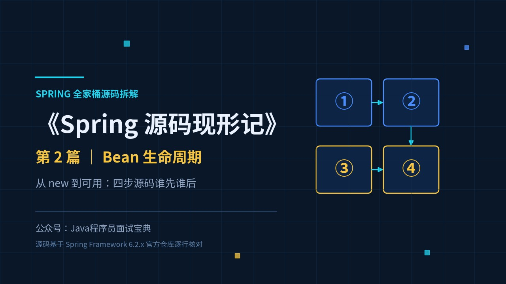
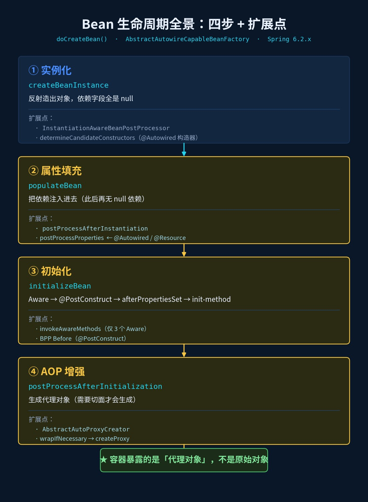
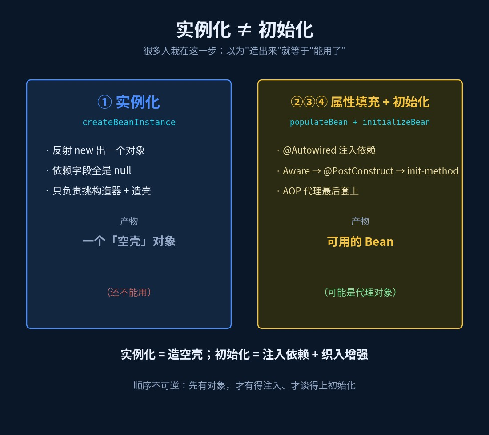
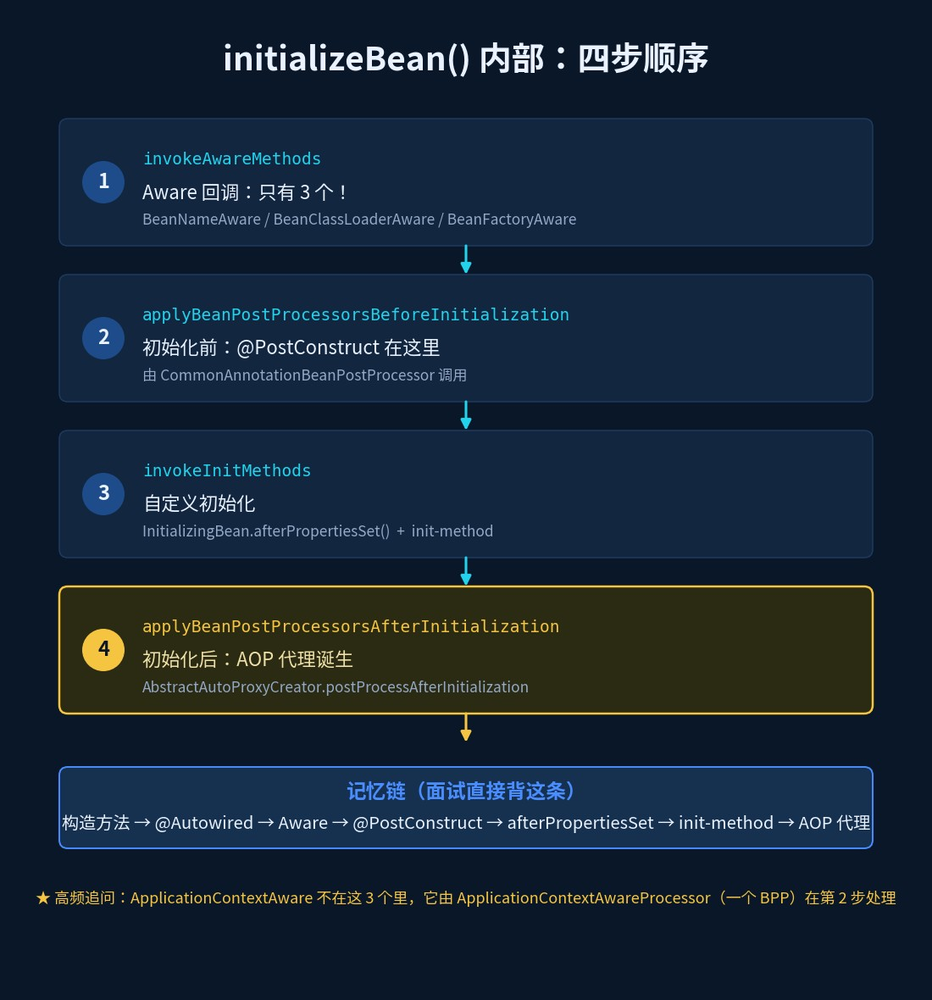
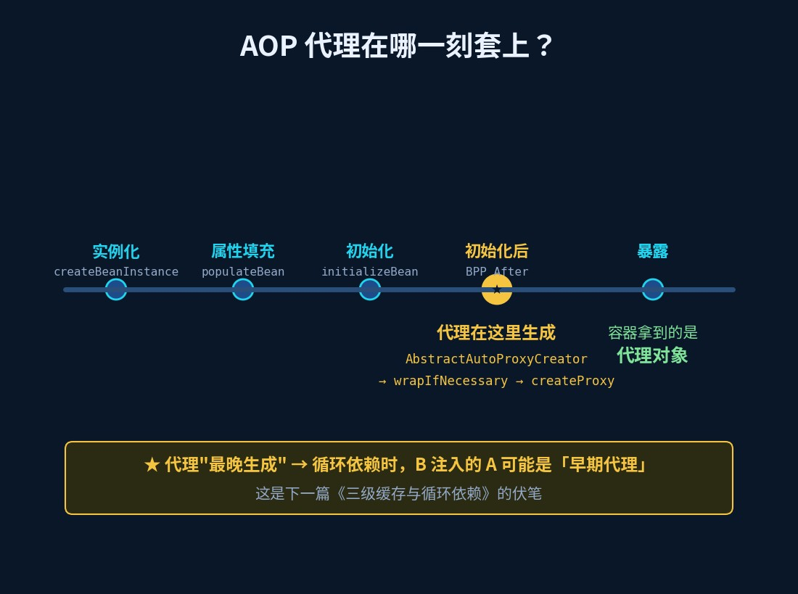

# Bean 生命周期：从 new 到可用，四步源码谁先谁后

> 《Spring 源码现形记》第 2 篇 ｜ 本文源码基于 Spring Framework 6.2.x 分支



## 一个把人问懵的"顺序题"

面试官："Bean 的生命周期，说说都有哪些阶段？"

候选人（熟练背诵）："实例化、属性赋值、初始化……还有销毁。"

面试官点点头，追问："那 `@Autowired` 注入、`@PostConstruct`、`InitializingBean`、AOP 代理，**这四件事的先后顺序**是什么？谁在谁前面？"

候选人：……

这就是 2026 年面试的典型路数：**谁都背过"Bean 生命周期"，但面试官要的是你把顺序讲对**。因为顺序背后是源码——顺序答错了，说明你只是背了张流程图，没读过代码。

这一篇，我们把 Bean 从"图纸"变成"成品"的每一步，按源码逐一归位。

## 旧问法 vs 新问法

| 旧问法（背就完事） | 新问法（要真读过源码） |
|---|---|
| Bean 生命周期有哪些阶段？ | 实例化、属性填充、初始化、AOP 增强，源码里谁先谁后？ |
| `@PostConstruct` 和 `afterPropertiesSet` 什么区别？ | 它们在 `initializeBean` 里分别由哪一步触发？ |
| Aware 接口有哪些？ | 为什么 `BeanFactoryAware` 由 Spring 直接调用，`ApplicationContextAware` 却要靠一个 BPP？ |

## 一切从 doCreateBean 开始

Bean 的创建入口是 `AbstractAutowireCapableBeanFactory.doCreateBean()`（上一篇章1 讲到的第 11 步 `preInstantiateSingletons` 最终会走到这里）。去掉异常处理和循环依赖的细节，主干只有几行：

```java
protected Object doCreateBean(String beanName, RootBeanDefinition mbd, Object[] args) {
    // ① 实例化：反射造出对象，此时依赖全是 null
    BeanWrapper instanceWrapper = createBeanInstance(beanName, mbd, args);
    Object bean = instanceWrapper.getWrappedInstance();

    // ② 收集注入元数据（@Autowired/@Value 标记的字段/方法）
    applyMergedBeanDefinitionPostProcessors(mbd, beanType, beanName);

    // ③ 提前暴露"早期引用"——这是解决循环依赖的关键（篇3 细讲）
    if (earlySingletonExposure) {
        addSingletonFactory(beanName, () -> getEarlyBeanReference(beanName, mbd, bean));
    }

    // ④ 属性填充：@Autowired 在这一步完成注入
    populateBean(beanName, mbd, instanceWrapper);

    // ⑤ 初始化：Aware、@PostConstruct、init-method、AOP 代理全在这
    exposedObject = initializeBean(beanName, exposedObject, mbd);
    return exposedObject;
}
```

是不是和你想的一样？**实例化 ≠ 初始化**，这是本题第一个坑，后面单独说。先把四步逐个拆开。





## 第一步：实例化（createBeanInstance）——挑一个构造器

"实例化"只干一件事：**把对象 new 出来**。此刻对象里的依赖字段全是 `null`。

`createBeanInstance` 内部按优先级依次判断：

1. `Supplier` 回调（如果注册了）；
2. `factoryMethod`（也就是你的 `@Bean` 方法）；
3. `determineConstructorsFromBeanPostProcessors()`——**交给 `@Autowired` 构造器**；
4. 最后兜底：`instantiateBean()`，用**无参构造**反射创建。

所以"构造器注入为什么被官方推荐"，在源码层的答案是：它有专门的选择逻辑（`ConstructorResolver` 会按类型匹配、真有多义再按 `@Primary`/`@Qualifier` 裁决），而字段注入只能等对象造好后再反射塞进去。

## 第二步：属性填充（populateBean）——@Autowired 在这一步

`populateBean` 的主干（6.2.x）：

```java
protected void populateBean(String beanName, RootBeanDefinition mbd, BeanWrapper bw) {
    // 给 InstantiationAwareBeanPostProcessor 一次"属性填充前"的机会
    for (InstantiationAwareBeanPostProcessor bp : getBeanPostProcessorCache().instantiationAware) {
        if (!bp.postProcessAfterInstantiation(bw.getWrappedInstance(), beanName)) {
            return;   // 返回 false，直接跳过整个属性填充
        }
    }
    // 关键一步：@Autowired / @Resource 注入就发生在这里
    for (InstantiationAwareBeanPostProcessor bp : getBeanPostProcessorCache().instantiationAware) {
        PropertyValues pvsToUse = bp.postProcessProperties(pvs, bw.getWrappedInstance(), beanName);
        ...
    }
    // XML 时代的 <property> 值在这里落地
    applyPropertyValues(beanName, mbd, bw, pvs);
}
```

管 `@Autowired` 的 `AutowiredAnnotationBeanPostProcessor`、管 `@Resource` 的 `CommonAnnotationBeanPostProcessor`，都是在 `postProcessProperties` 这一步被调用的。

**记住这句话**：走到这里，对象已经存在了，只是依赖刚被"塞"进去。

## 第三步：初始化（initializeBean）——四个子步骤，顺序是考点

这是本篇的核心。`initializeBean` 全文不长，但每一步都是面试题：

```java
protected Object initializeBean(String beanName, Object bean, RootBeanDefinition mbd) {
    // ① Aware 回调（只有 3 个！）
    invokeAwareMethods(beanName, bean);

    // ② 初始化前：@PostConstruct 在这里执行
    wrappedBean = applyBeanPostProcessorsBeforeInitialization(wrappedBean, beanName);

    // ③ 初始化：InitializingBean + 自定义 init-method
    invokeInitMethods(beanName, wrappedBean, mbd);

    // ④ 初始化后：AOP 代理在这一步生成
    wrappedBean = applyBeanPostProcessorsAfterInitialization(wrappedBean, beanName);
    return wrappedBean;
}
```

拆开看：

**① invokeAwareMethods**：源码里只处理三个接口——`BeanNameAware`、`BeanClassLoaderAware`、`BeanFactoryAware`。高频追问来了：那 `ApplicationContextAware`、`EnvironmentAware` 呢？答案是它们**不在这里**，而是由 `ApplicationContextAwareProcessor`（一个 BeanPostProcessor）在第 ② 步执行的。这就是"为什么官方说 Aware 系列的时机不完全一样"的源码依据。

**② applyBeanPostProcessorsBeforeInitialization**：所有 BPP 的"初始化前"方法依次执行。`@PostConstruct` 标注的方法，就由 `CommonAnnotationBeanPostProcessor` 在这一步调用。

**③ invokeInitMethods**：先判断是否实现 `InitializingBean`，是就调 `afterPropertiesSet()`；再执行配置里声明的自定义 `init-method`。

**④ applyBeanPostProcessorsAfterInitialization**：**AOP 代理在这里诞生。**



## 第四步：AOP 代理——严格说，它是"初始化的最后一秒"

为什么说 AOP 代理是第四步？看 `AbstractAutoProxyCreator.postProcessAfterInitialization()`：

```java
public Object postProcessAfterInitialization(Object bean, String beanName) {
    if (bean != null) {
        Object cacheKey = getCacheKey(bean.getClass(), beanName);
        if (this.earlyBeanReferences.remove(cacheKey) != bean) {
            return wrapIfNecessary(bean, beanName, cacheKey);  // 需要就生成代理
        }
    }
    return bean;
}
```

`wrapIfNecessary` 里做判断：这个 Bean 有没有匹配的切面？有就 `createProxy` 生成代理对象，没有就原样返回。

**所以完整顺序是**：

```
构造方法 → @Autowired 注入 → Aware(3 个) → @PostConstruct → afterPropertiesSet → init-method → AOP 代理
```

背下这条链，面试官问"谁先谁后"就稳了。



## 加分点：AOP 代理"最晚生成"，埋下了循环依赖的伏笔

这是本篇最值钱的一句话：

**AOP 代理在所有初始化动作都完成之后才生成，所以容器最终暴露给你的，是代理对象，不是原始对象。**

这句话直接解释了一个经典问题：**为什么循环依赖时，B 注入的 A 可能是个"半成品代理"？**

因为在 A 的实例化完成后、初始化完成前，为了打破循环，A 会被提前暴露（`getEarlyBeanReference`）给 B。如果 A 恰好需要 AOP 代理，这个"早期引用"就可能是**提前生成的代理**。而如果 A 根本不需要代理，早期引用就是原始对象——同一个机制，两种结果，这也是三级缓存里 `ObjectFactory` 存在的原因。

这个坑我们留到下一篇《三级缓存与循环依赖》一次讲透。

## 全生命周期扩展点速查表

| 时机 | 扩展点接口 | 谁在用 |
|---|---|---|
| 实例化前 | `InstantiationAwareBeanPostProcessor.postProcessBeforeInstantiation` | 可返回代理，直接短路掉实例化 |
| 选择构造器 | `SmartInstantiationAwareBeanPostProcessor.determineCandidateConstructors` | `@Autowired` 构造器 |
| 实例化后、注入前 | `postProcessAfterInstantiation` | 可返回 false 跳过属性填充 |
| **属性填充（注入）** | `postProcessProperties` | **`@Autowired` / `@Resource`** |
| 合并定义后 | `MergedBeanDefinitionPostProcessor.postProcessMergedBeanDefinition` | 收集注入元数据（`@Autowired`/`@Value`） |
| 初始化前 | `BeanPostProcessor.postProcessBeforeInitialization` | **`@PostConstruct`**、`ApplicationContextAwareProcessor` |
| 初始化 | `InitializingBean` / `init-method` | 自定义初始化逻辑 |
| **初始化后** | `postProcessAfterInitialization` | **AOP 代理** |

## 四步速查

| 步骤 | 方法 | 干什么 | 记忆锚点 |
|---|---|---|---|
| ① 实例化 | `createBeanInstance` | 反射造对象，依赖还是 null | 选构造器 |
| ② 属性填充 | `populateBean` | 注入依赖 | **`@Autowired` 在这** |
| ③ 初始化 | `initializeBean` | Aware → `@PostConstruct` → afterPropertiesSet → init-method | 四小步顺序 |
| ④ AOP 增强 | `applyBeanPostProcessorsAfterInitialization` | 生成代理 | **最晚发生** |

## 动手验证（10 分钟）

1. 一个类里同时写：无参构造、`@Autowired` 构造器、`@PostConstruct` 方法、`afterPropertiesSet`、自定义 `init-method`——每个都打日志，跑一遍看**真实顺序**，和我上面那条链对一对；
2. 把 `@PostConstruct` 方法里的字段打印出来，确认此时 `@Autowired` 已经注入完成；
3. 在 `@PostConstruct` 和 `afterPropertiesSet` 里各 `System.out.println(this.getClass())`——如果这个 Bean 有切面，两次打印的类名可能已经在悄悄变化（代理在最后一刻才套上）。

## 下一篇预告

A 依赖 B，B 依赖 A，Spring 到底怎么把它们造出来？三级缓存各存什么、`ObjectFactory` 为什么要延迟生成、构造器注入为什么救不了——下一篇：《三级缓存与循环依赖：为什么构造器注入救不了》。
