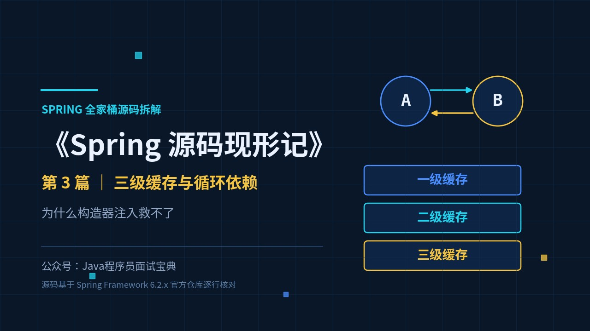
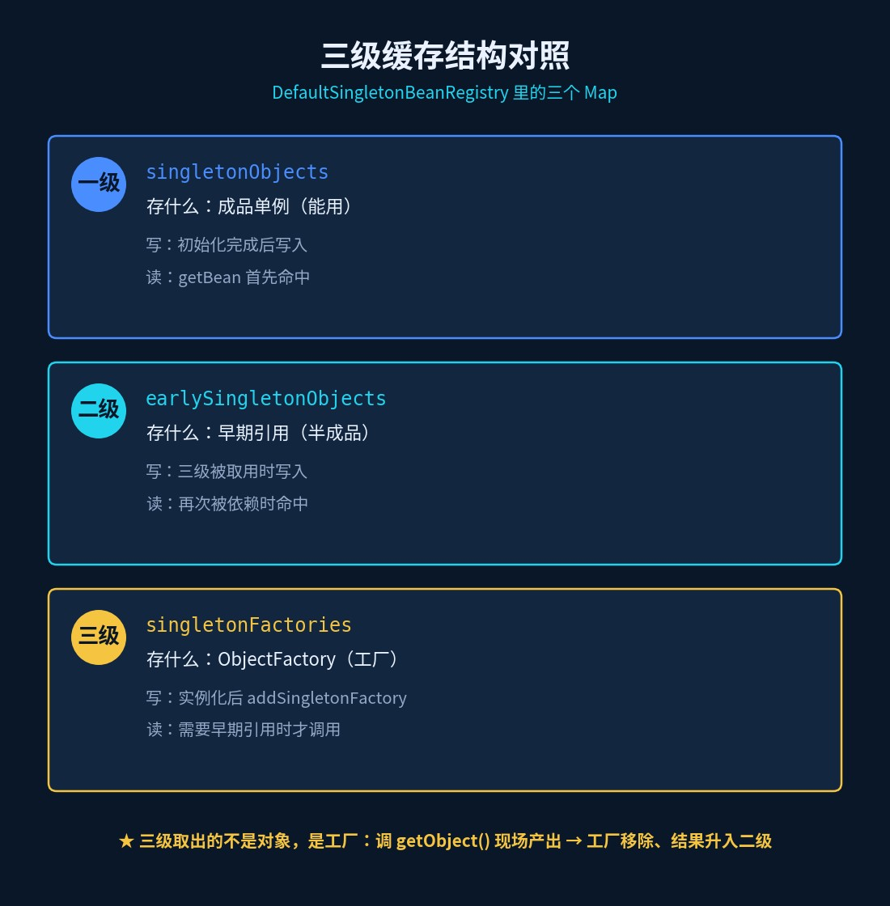
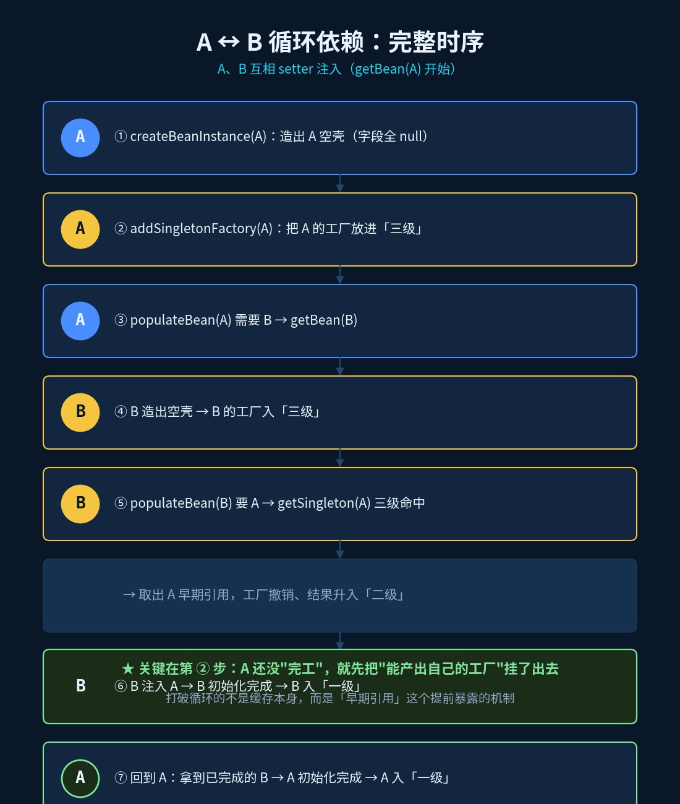
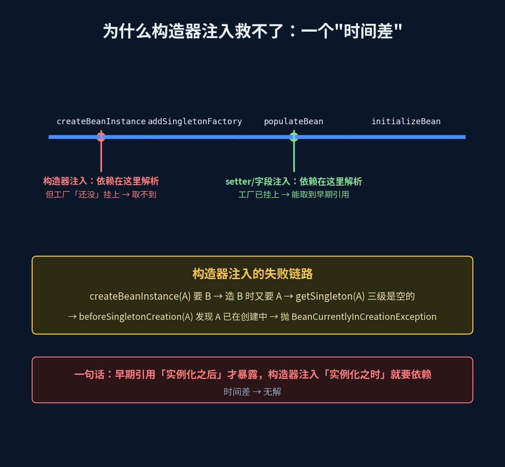
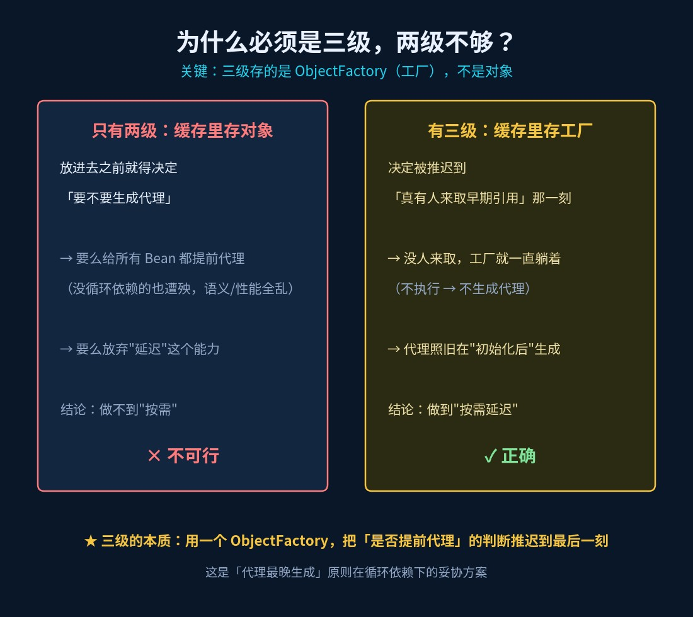

# 三级缓存与循环依赖：为什么构造器注入救不了

> 《Spring 源码现形记》第 3 篇 ｜ 源码基于 Spring Framework 6.2.x 分支



## 三道追问，卡住一片人

面试官："Spring 怎么解决循环依赖？"

候选人（脱口而出）："三级缓存。"

面试官："那三级缓存分别存什么？为什么必须三级，两级行不行？还有——**为什么构造器注入救不了**？"

前两个问题还能撑一撑，第三个基本当场哑火。

这三个追问，是一道题的三层。答对第一层靠背，答对第三层靠**真的读过源码**。这一篇，一次讲透。

## 旧问法 vs 新问法

| 旧问法（背就完事） | 新问法（要真读过源码） |
|---|---|
| Spring 怎么解决循环依赖？ | 三级缓存分别存什么？`getSingleton` 怎么查？ |
| 什么是循环依赖？ | 为什么 setter 注入能解决、构造器注入直接报错？ |
| 知道 `BeanCurrentlyInCreationException` 吗？ | `getEarlyBeanReference` 为什么要"延迟"生成代理？ |

## 一、先把三级缓存摆出来

三个 Map 都在 `DefaultSingletonBeanRegistry` 里：

```java
public class DefaultSingletonBeanRegistry {
    // 一级：成品（完全初始化好的单例）
    private final Map<String, Object> singletonObjects = new ConcurrentHashMap<>(256);
    // 三级：ObjectFactory（能"生产"早期引用的工厂）
    private final Map<String, ObjectFactory<?>> singletonFactories = new ConcurrentHashMap<>(16);
    // 二级：半成品（早期引用，从三级取出来后缓存在这）
    private final Map<String, Object> earlySingletonObjects = new ConcurrentHashMap<>(16);
}
```

记忆口诀：

- **一级**：成品（能用）；
- **二级**：半成品（早期引用）；
- **三级**：能造半成品的**工厂**。

⚠️ 冷知识：源码里三个 Map 的声明顺序是"一级 → 三级 → 二级"，不是按级别排的，第一次看容易被绕晕。



## 二、怎么取：getSingleton 的三级查找

```java
protected Object getSingleton(String beanName, boolean allowEarlyReference) {
    Object singletonObject = this.singletonObjects.get(beanName);            // ① 查一级
    if (singletonObject == null && isSingletonCurrentlyInCreation(beanName)) {
        singletonObject = this.earlySingletonObjects.get(beanName);          // ② 查二级
        if (singletonObject == null && allowEarlyReference) {
            // 加锁（6.2 起是 singletonLock.tryLock()，旧版是 synchronized 块）
            singletonObject = this.singletonObjects.get(beanName);
            if (singletonObject == null) {
                singletonObject = this.earlySingletonObjects.get(beanName);
                if (singletonObject == null) {
                    ObjectFactory<?> singletonFactory = this.singletonFactories.get(beanName);  // ③ 查三级
                    if (singletonFactory != null) {
                        singletonObject = singletonFactory.getObject();      // 现场"生产"出早期引用
                        this.singletonFactories.remove(beanName);
                        this.earlySingletonObjects.put(beanName, singletonObject); // 工厂撤走，结果升到二级
                    }
                }
            }
        }
    }
    return singletonObject;
}
```

**划重点**：从三级取出来的不是对象，是**工厂**；调用 `getObject()` 现场产出对象，然后"工厂移除、结果升入二级"。这就是三级到二级的转移。

## 三、A ↔ B：完整走一遍时序



场景：A、B 互相依赖（setter/字段注入），`getBean(A)` 开始：

| 步 | 发生了什么 | 三级缓存状态 |
|---|---|---|
| 1 | `createBeanInstance(A)`：用无参构造造出 **A 空壳**（字段全 null） | 全空 |
| 2 | `addSingletonFactory(A, () -> getEarlyBeanReference(A))` | 三级：A 的工厂 ✅ |
| 3 | `populateBean(A)` 发现要注入 B → `getBean(B)` | — |
| 4 | B 造出空壳 → B 的工厂入三级 → `populateBean(B)` 要 A | 三级：A 的工厂、B 的工厂 |
| 5 | `getSingleton(A, true)`：一级无、二级无 → **三级命中** → `getObject()` 拿到 A 早期引用 | 三级撤 A，**二级：A** |
| 6 | B 注入 A → B 初始化完成 → **B 入一级** | 一级：B，二级：A |
| 7 | 回到 A：`populateBean(A)` 拿到已完成的 B → A 初始化 → **A 入一级** | 一级：A、B（二级清空） |

到这里循环被打破。关键就在**第 2 步**——A 在还没"完工"时，就先把"能产出自己的工厂"挂了出去。

## 四、getEarlyBeanReference：代理为什么能"提前"生成

```java
protected Object getEarlyBeanReference(String beanName, RootBeanDefinition mbd, Object bean) {
    Object exposedObject = bean;
    if (!mbd.isSynthetic() && hasInstantiationAwareBeanPostProcessors()) {
        for (SmartInstantiationAwareBeanPostProcessor bp : getBeanPostProcessorCache().smartInstantiationAware) {
            exposedObject = bp.getEarlyBeanReference(exposedObject, beanName);
        }
    }
    return exposedObject;
}
```

`AbstractAutoProxyCreator` 实现了这个接口——**如果 A 需要 AOP 代理，这一调用就会提前把代理造出来**。

这就接上了上一篇的伏笔：篇2 说"AOP 代理在初始化之后才生成"，而这里，代理被循环依赖**逼着提前**生成了。所以——**B 注入的 A，可能直接就是代理对象**。

## 五、为什么构造器注入救不了（本题的"灵魂拷问"）

回看时序的**第 1、2 步**：`addSingletonFactory` 写在 `createBeanInstance` **之后**。

而构造器注入的依赖，恰恰要在 `createBeanInstance` **之中**解析——A 还没造出来，工厂根本没挂上去。

于是：

1. `getBean(A)` → `createBeanInstance(A)` 发现构造器要 B → `getBean(B)`；
2. B 的构造器又要 A → `getBean(A)` → `getSingleton(A, true)`：一级无、二级无、**三级也是空的**（工厂还没放）→ 返回 `null`；
3. 于是尝试重新创建 A → 进 `beforeSingletonCreation(A)`：

```java
protected void beforeSingletonCreation(String beanName) {
    if (!this.inCreationCheckExclusions.contains(beanName) && !this.singletonsCurrentlyInCreation.add(beanName)) {
        throw new BeanCurrentlyInCreationException(beanName);
    }
}
```

A 早已在 `singletonsCurrentlyInCreation` 里 → 直接抛异常：

```
Error creating bean with name 'a': Requested bean is currently in creation:
Is there an unresolvable circular reference?
```



**一句话总结**：早期引用是"实例化**之后**"才暴露的，而构造器注入在"实例化**之时**"就需要依赖——**时间差**，无解。

## 六、加分点：为什么必须是三级，两级不够？

很多人答："存个 Map 而已，两级也够。" ——错。

关键在于：**三级存的是 `ObjectFactory`，不是对象。**

- 若**只有两级**（直接存对象）：那"要不要生成代理"这个决定，必须在放进缓存**之前**就拍板——可问题是，一个刚实例化完的 Bean，你怎么知道它将来会不会被 AOP 代理？要么给所有 Bean 都提前套代理（没循环依赖的也遭殃，语义、性能全乱），要么放弃延迟。
- 有了**三级的工厂**：决定被**推迟**到"真有人来取早期引用"那一刻。没人取，工厂就一直躺着不执行——代理照旧按正常流程在"初始化后"生成。

所以三级的本质是：**用一个 `ObjectFactory`，把"是否提前代理"的判断推迟到最后一刻**。



这是"代理最晚生成"这条原则，在循环依赖场景下的**妥协方案**。

> 补充：Spring Boot 2.6 起 `spring.main.allow-circular-references` 默认为 `false`（已核对官方配置元数据）——想亲手复现循环依赖，先要手动打开这个开关。

## 速查表

| 缓存 | 存什么 | 什么时候写 | 什么时候读 |
|---|---|---|---|
| 一级 `singletonObjects` | 成品单例 | 初始化完成后 | `getBean` 首先命中 |
| 二级 `earlySingletonObjects` | 早期引用（半成品） | 三级被取用时 | 再次被依赖时 |
| 三级 `singletonFactories` | `ObjectFactory` | 实例化后 `addSingletonFactory` | 需要早期引用时 |

| 注入方式 | 能否解决循环依赖 | 原因 |
|---|---|---|
| setter / 字段注入 | ✅ | 依赖在"实例化之后"才需要，早期引用已就位 |
| 构造器注入 | ❌ | 依赖在"实例化之时"就需要，工厂还没挂上 |
| `@Lazy` | ✅（变通） | 注入代理，真正使用时才解析 |

## 动手验证（15 分钟）

1. 两个 Bean 互相 setter 注入，在 `getSingleton` 三级查找处打断点——看它一路查到三级、回填二级；
2. 把注入方式改成构造器，观察 `BeanCurrentlyInCreationException` 的报错原文；
3. 给其中一个依赖加 `@Lazy`，构造器注入也能过——体会"把解析推迟到使用时"；
4. 记得 Spring Boot 2.6+ 默认禁止循环依赖，先 `spring.main.allow-circular-references=true`。

## 下一篇预告

`@Autowired` 到底怎么把一个字段"塞"进去的？反射 `field.set` 做了哪些事、构造器注入为什么被官方推荐？下一篇：《@Autowired 注入源码：字段怎么被反射 set 进去的》。
