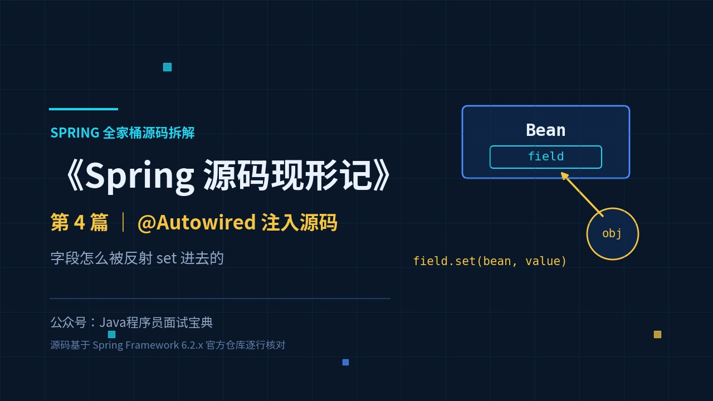
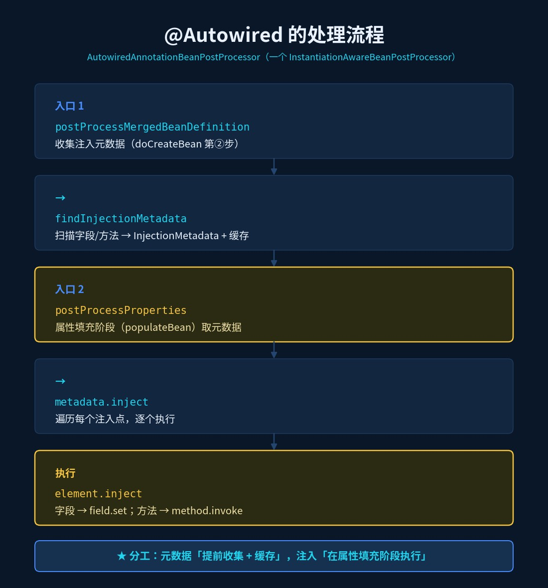
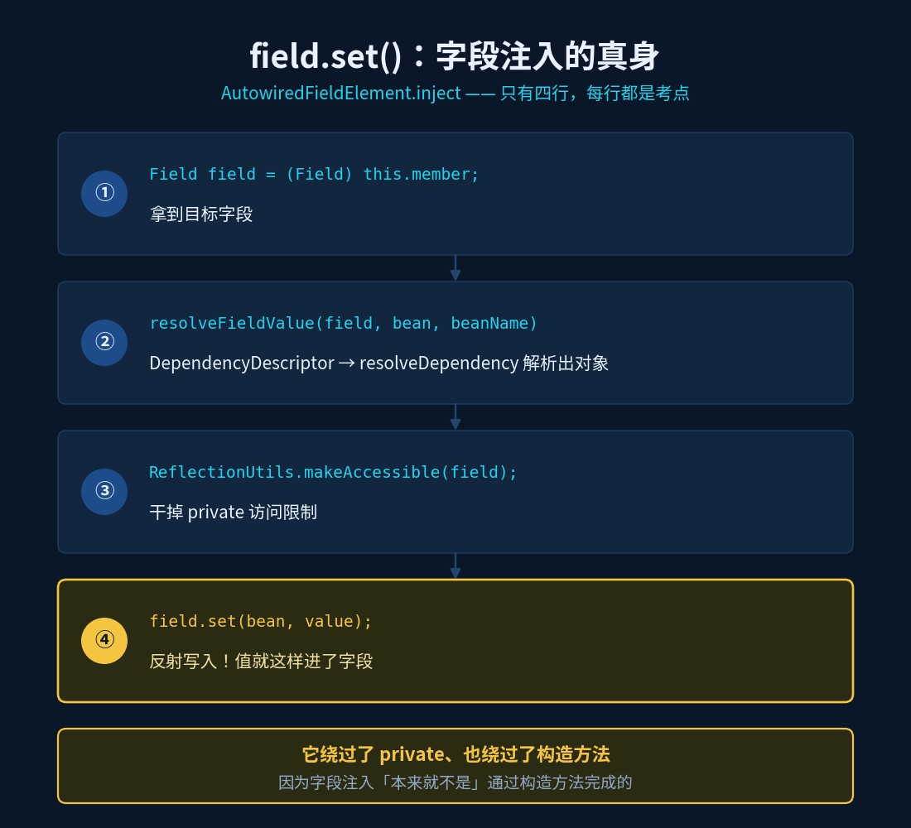
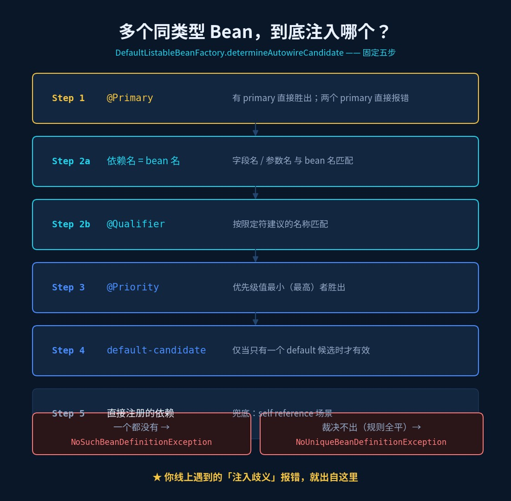
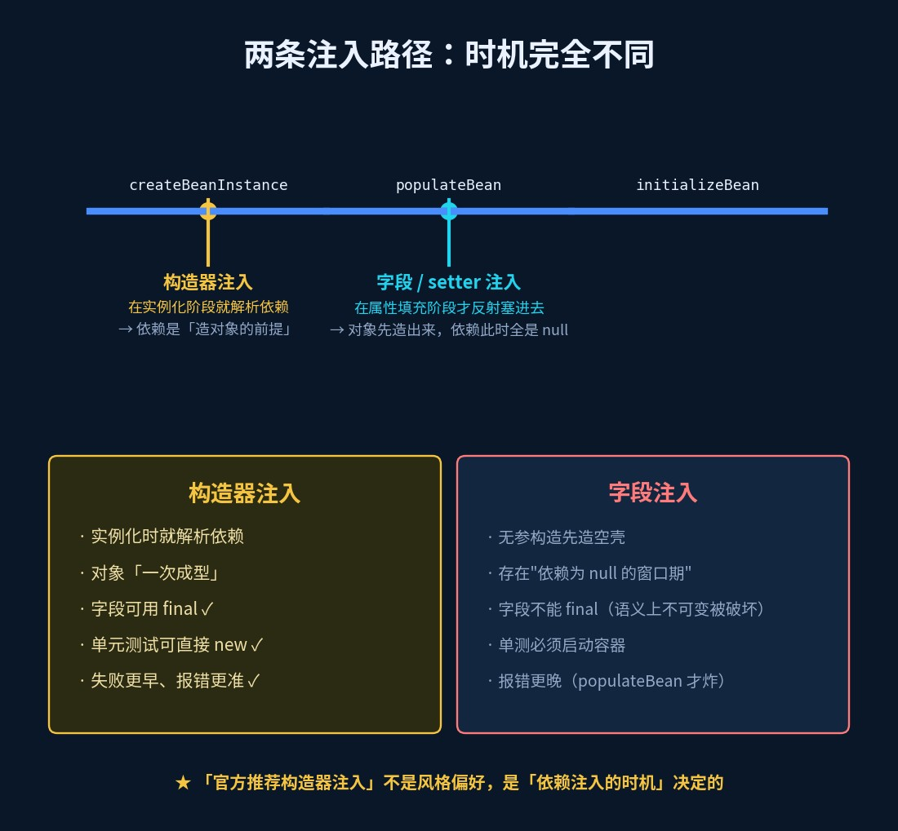

# @Autowired 注入源码：字段怎么被反射 set 进去的

> 《Spring 源码现形记》第 4 篇 ｜ 源码基于 Spring Framework 6.2.x 分支



## 背完"byType 和 byName"，追问就来了

面试官："`@Autowired` 和 `@Resource` 有什么区别？"

候选人："`@Autowired` 默认按类型注入，`@Resource` 默认按名称注入。"

面试官："嗯。那 `@Autowired` **具体怎么把一个 Bean 塞进你的字段里的**？用的是反射吗？反射做了什么？"

候选人：……

"默认按类型"这句话，能背出来的人很多；能说出"类型匹配之后是谁把值写进字段"的，不多。这一篇就把这最后一百米走完——**看 `field.set()` 那一行**。

## 旧问法 vs 新问法

| 旧问法（背就完事） | 新问法（要真读过源码） |
|---|---|
| `@Autowired` 按类型还是按名称？ | 类型匹配完之后，是谁把值写进字段的？ |
| `@Autowired` 和 `@Resource` 的区别？ | 多个同类型 Bean 时，源码按什么顺序裁决用哪个？ |
| 为什么推荐构造器注入？ | 字段注入和构造器注入，在源码里走的是**两条完全不同的路**——差在哪？ |

## 一、谁在处理 @Autowired

处理 `@Autowired` 的是 `AutowiredAnnotationBeanPostProcessor`——它是个 `InstantiationAwareBeanPostProcessor`（还记得篇2 讲的扩展点吗？）。它有两个入口：

```java
// 入口一：收集注入元数据（在 doCreateBean 的第②步）
public void postProcessMergedBeanDefinition(RootBeanDefinition bd, Class<?> beanType, String beanName) {
    findInjectionMetadata(beanName, beanType, bd);
}

// 入口二：真正执行注入（在 populateBean 的 postProcessProperties）
public PropertyValues postProcessProperties(PropertyValues pvs, Object bean, String beanName) {
    InjectionMetadata metadata = findAutowiringMetadata(beanName, bean.getClass(), pvs);
    metadata.inject(bean, beanName, pvs);   // ← 注入在这里发生
    return pvs;
}
```

注意这个分工：**元数据提前收集（还带缓存），注入在属性填充阶段执行**。这就是"注解解析一次、注入多次复用"的实现方式。



## 二、metadata.inject：逐个注入点执行

`InjectionMetadata` 内部存着一份"注入点清单"（字段、方法各算一个 element）：

```java
public void inject(Object target, String beanName, PropertyValues pvs) throws Throwable {
    for (InjectedElement element : elementsToIterate) {
        element.inject(target, beanName, pvs);   // 字段元素、方法元素各走各的
    }
}
```

## 三、字段注入的真身：field.set()

`@Autowired` 字段对应的是 `AutowiredFieldElement`，它的 `inject` 只有几行，但每一行都是考点：

```java
protected void inject(Object bean, String beanName, PropertyValues pvs) throws Throwable {
    Field field = (Field) this.member;                    // ① 拿到字段
    Object value = resolveFieldValue(field, bean, beanName);  // ② 解析出要注入的对象
    if (value != null) {
        ReflectionUtils.makeAccessible(field);            // ③ 干掉 private 限制
        field.set(bean, value);                           // ④ 反射写入！
    }
}
```

`resolveFieldValue` 里则是标准的依赖解析：

```java
DependencyDescriptor desc = new DependencyDescriptor(field, this.required);
Object value = beanFactory.resolveDependency(desc, beanName, autowiredBeanNames, typeConverter);
```

**到这里，"字段怎么被塞进去的"就有答案了**：`ReflectionUtils.makeAccessible(field)` + `field.set(bean, value)`。它绕过了 private、绕过了构造方法——**因为它压根不是通过构造方法注入的**。



## 四、类型匹配之后：多个候选怎么裁决

`resolveDependency` 走到 `DefaultListableBeanFactory.doResolveDependency`，按类型找到候选。候选超过一个时，`determineAutowireCandidate` 按**固定的五步**裁决（6.2.x 源码注释就是 Step 1~5）：

| 顺序 | 依据 | 说明 |
|---|---|---|
| Step 1 | `@Primary` | 有 primary 直接胜出；两个 primary 直接报错 |
| Step 2a | 依赖名 = bean 名 | 字段名/参数名与 bean 名匹配 |
| Step 2b | `@Qualifier` | 按限定符建议的名称匹配 |
| Step 3 | `@Priority` | 优先级值最小（最高）者胜出 |
| Step 4 | default-candidate | 唯一一个 default 候选才有效 |
| Step 5 | 直接注册的依赖 | 兜底：self reference 场景 |

一个都没有 → `NoSuchBeanDefinitionException`；裁决不出来（多个候选、规则全平）→ `NoUniqueBeanDefinitionException`。**你线上遇到的"注入歧义"报错，就出自这里。**



## 五、构造器注入是另一条路

字段注入走 `populateBean`，构造器注入走的是**更早的 `createBeanInstance`**：

```java
// createBeanInstance 内部
Constructor<?>[] ctors = determineConstructorsFromBeanPostProcessors(beanClass, beanName);
if (ctors != null || ...) {
    return autowireConstructor(beanName, mbd, ctors, args);   // ← ConstructorResolver 出场
}
```

`ConstructorResolver.autowireConstructor` 会：候选构造器排序 → 逐个尝试按类型解析参数 → 有歧义再按 `@Qualifier`/`@Primary` 收窄 → 最后选出一个构造器并反射调用。



看懂这张图，就理解了关键差别：

- **构造器注入**：依赖在**实例化阶段**解析 → 依赖是"造对象的前提"；
- **字段注入**：对象先用无参构造造出来（此时依赖全是 null）→ 再到 `populateBean` 里反射塞进去。

## 六、加分点：为什么官方推荐构造器注入（用源码说话）

不吹不黑，就事论事，源码层面有三条：

1. **完整性**：字段注入出来的对象，存在一段"依赖是 null"的窗口期；构造器注入的对象，一造出来就是"完整可用"的——**字段可以用 `final` 修饰**；
2. **可测性**：构造器注入的依赖是显式参数，单元测试可以直接 `new`；字段注入则必须启动容器（或反射注入）才能拿到依赖；
3. **失败更早**：构造器注入在实例化阶段就暴露问题，字段注入要等 `populateBean` 才报错——**报错越早，排查越省事**。

所以"官方推荐构造器注入"不是风格偏好，是**依赖注入的时机**决定的。

## 附：@Resource 走的是另一套

`@Resource` 由 `CommonAnnotationBeanPostProcessor` 处理，核心在 `autowireResource`：

```java
String name = element.name;
if (this.fallbackToDefaultTypeMatch && element.isDefaultName && !factory.containsBean(name)) {
    // 名称不存在时，才回退到按类型
    resource = autowireCapableBeanFactory.resolveDependency(...);
}
else {
    // 默认：按名称解析
    resource = autowireCapableBeanFactory.resolveBeanByName(name, element.getDependencyDescriptor());
}
```

所以准确表述是：**`@Resource` 默认按名称（未写 `name` 就取字段名），找不到才回退按类型**——"按名称"来自 `resolveBeanByName`，不是背出来的。

## 速查表

| 问题 | 答案（源码依据） |
|---|---|
| 谁处理 `@Autowired`？ | `AutowiredAnnotationBeanPostProcessor`（两入口：收集元数据 + 执行注入） |
| 字段怎么被写入？ | `ReflectionUtils.makeAccessible(field)` + `field.set(bean, value)` |
| 什么时候写入？ | `populateBean` 的 `postProcessProperties`（属性填充阶段） |
| 多个候选怎么选？ | `determineAutowireCandidate`：@Primary → 名字 → @Qualifier → @Priority → default |
| 构造器注入在哪解析？ | `createBeanInstance` 阶段，`ConstructorResolver.autowireConstructor` |
| `@Resource` 怎么解析？ | `CommonAnnotationBeanPostProcessor.autowireResource`，默认 `resolveBeanByName` |

## 动手验证（10 分钟）

1. 在 `AutowiredFieldElement.inject` 的 `field.set(bean, value)` 打断点——你会亲眼看到值是怎么被反射塞进去的；
2. 造两个同类型 Bean，一个加 `@Primary`，观察 `determinePrimaryCandidate` 怎么一票当选；
3. 两个都不加、直接注入，故意制造 `NoUniqueBeanDefinitionException`，看它把候选名单全列给你；
4. 把字段注入改成构造器注入，把字段声明成 `final`——感受"对象一造出来就完整"。

## 下一篇预告

`@Autowired` 注入的是对象，但**有切面的 Bean 注入进去的其实是代理**。Spring 到底怎么决定用 JDK 动态代理还是 CGLIB？代理链 `proceed()` 又是怎么一层层执行的？下一篇：《AOP 代理生成：Spring 怎么决定用 JDK 还是 CGLIB》。
