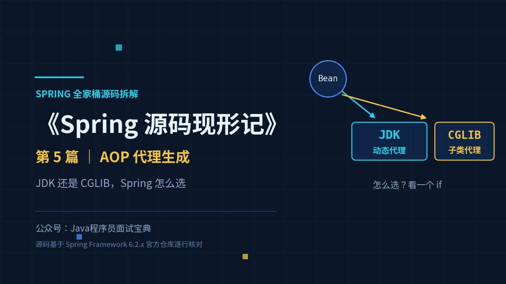
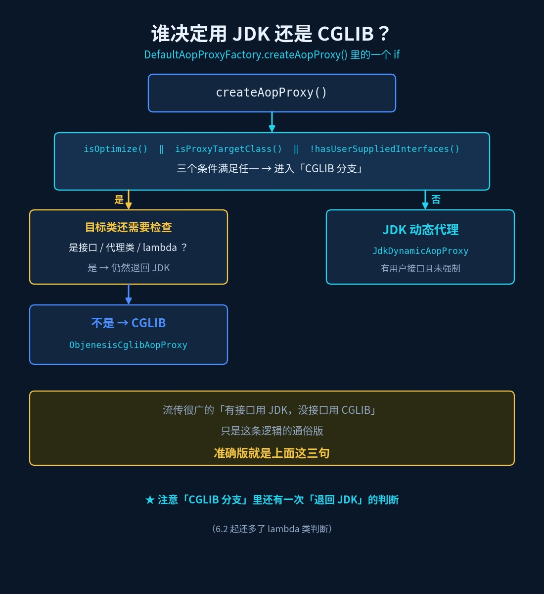
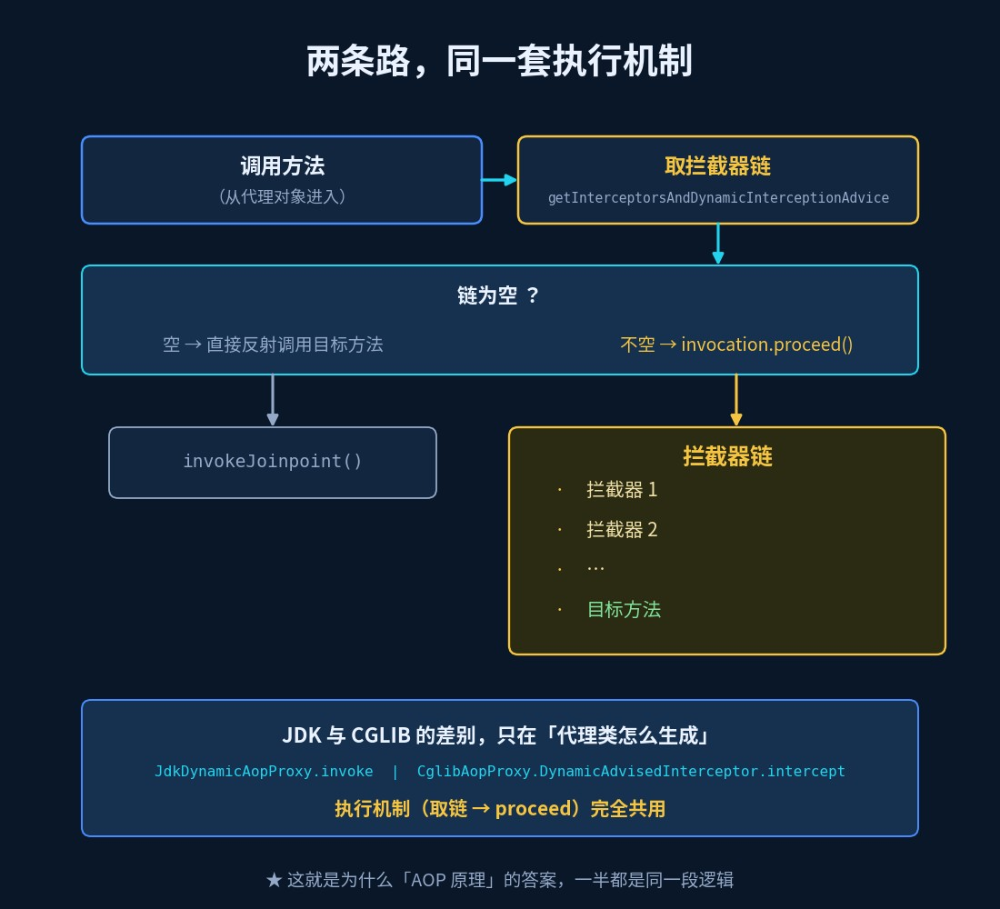
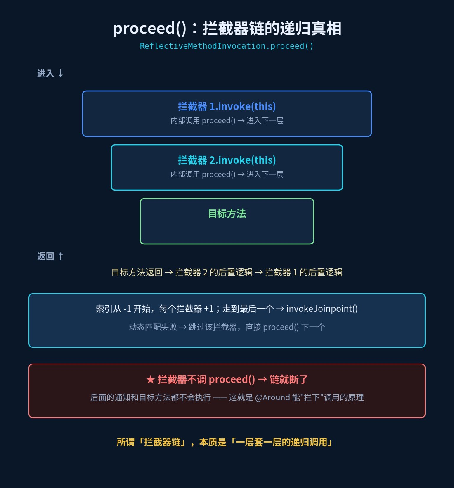
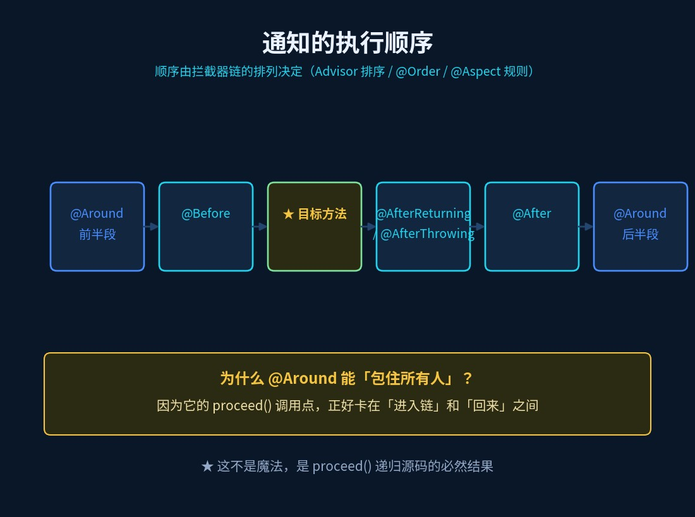

# AOP 代理生成：Spring 怎么决定用 JDK 还是 CGLIB

> 《Spring 源码现形记》第 5 篇 ｜ 源码基于 Spring Framework 6.2.x 分支



## 一个"我好像知道"的经典问题

面试官："说说 Spring AOP 的原理。"

候选人："基于动态代理，JDK 动态代理和 CGLIB。"

面试官："那 Spring **怎么决定**用哪个？为什么 Spring Boot 项目里，你给类加了 `@Transactional` 之后，注入的明明是实现类的类型也能生效？"

候选人：……

AOP 这道题，前两句谁都会背。但从第三句开始，就在考**你有没有真的看过 `createAopProxy` 那个 if**。

## 旧问法 vs 新问法

| 旧问法（背就完事） | 新问法（要真读过源码） |
|---|---|
| Spring AOP 的原理是什么？ | 代理是谁在什么时候生成的？ |
| JDK 代理和 CGLIB 代理的区别？ | Spring 用什么逻辑**决定**用哪一个？ |
| 为什么 Spring Boot 默认 CGLIB？ | 拦截器链是怎么执行的？`proceed()` 递归到哪结束？ |

## 一、先定位：代理是什么时候生成的（承接篇2）

篇2 讲过：Bean 初始化完成后，`BeanPostProcessor` 的后置阶段会执行 `AbstractAutoProxyCreator.postProcessAfterInitialization` → `wrapIfNecessary`：

```java
Object[] specificInterceptors = getAdvicesAndAdvisorsForBean(bean.getClass(), beanName, null);
if (specificInterceptors != DO_NOT_PROXY) {
    Object proxy = createProxy(bean.getClass(), beanName, specificInterceptors, new SingletonTargetSource(bean));
    ...
    return proxy;   // 返回的是代理对象，不是原始对象
}
return bean;
```

**有匹配的切面 → 生成代理；没有 → 原样返回**。这解释了篇4 的悬念：为什么注入进去的可能是代理。

## 二、谁来决定代理方式：DefaultAopProxyFactory

`createProxy` 最终会走到 `DefaultAopProxyFactory.createAopProxy`，这个 if 就是答案（6.2.x）：

```java
public AopProxy createAopProxy(AdvisedSupport config) throws AopConfigException {
    if (config.isOptimize() || config.isProxyTargetClass() || !config.hasUserSuppliedInterfaces()) {
        Class<?> targetClass = config.getTargetClass();
        if (targetClass == null && config.getProxiedInterfaces().length == 0) {
            throw new AopConfigException("TargetSource cannot determine target class: ...");
        }
        if (targetClass == null || targetClass.isInterface() ||
                Proxy.isProxyClass(targetClass) || ClassUtils.isLambdaClass(targetClass)) {
            return new JdkDynamicAopProxy(config);
        }
        return new ObjenesisCglibAopProxy(config);
    }
    else {
        return new JdkDynamicAopProxy(config);
    }
}
```

拆成三句话：

1. **满足任一条件就进"CGLIB 分支"**：`isOptimize()` / `isProxyTargetClass()`（即 `proxyTargetClass=true`）/ **没有用户提供的接口**（`!hasUserSuppliedInterfaces()`）；
2. 进了这个分支，如果**目标类本身就是接口**（或已是代理类、lambda 类），仍然退回 `JdkDynamicAopProxy`；
3. **否则**（有用户接口、且没强制 `proxyTargetClass`）→ `JdkDynamicAopProxy`。

所以那句流传很广的"**有接口用 JDK，没接口用 CGLIB**"，只是这条逻辑的**通俗版**——准确的版本是上面这三句。



## 三、代理生成之后：两条路，同一套执行机制

不管用哪种代理，**方法被调用时的处理是一样的**。

**JDK 路线**（`JdkDynamicAopProxy.invoke`）：

```java
// 构建拦截器链
List<Object> chain = this.advised.getInterceptorsAndDynamicInterceptionAdvice(method, targetClass);
if (chain.isEmpty()) {
    // 没有通知 → 直接反射调用目标方法
    retVal = AopUtils.invokeJoinpointUsingReflection(target, method, argsToUse);
}
else {
    // 有通知 → 交给 MethodInvocation 去"跑链"
    MethodInvocation invocation = new ReflectiveMethodInvocation(proxy, target, method, args, targetClass, chain);
    retVal = invocation.proceed();
}
```

**CGLIB 路线**（`CglibAopProxy.DynamicAdvisedInterceptor.intercept`）：

```java
List<Object> chain = this.advised.getInterceptorsAndDynamicInterceptionAdvice(method, targetClass);
if (chain.isEmpty()) {
    retVal = AopUtils.invokeJoinpointUsingReflection(target, method, argsToUse);
}
else {
    retVal = new CglibMethodInvocation(proxy, target, method, args, targetClass, chain, methodProxy).proceed();
}
```

看出共同点了吗？**取链 → 链空就直接调用 → 链不空就 `proceed()`**。JDK 和 CGLIB 的差别只在"代理类怎么生成"，**执行机制完全共用**。



## 四、proceed()：拦截器链的递归真相

这是本篇最值钱的一段代码：

```java
public Object proceed() throws Throwable {
    // 链走完了 → 反射调用真正的目标方法
    if (this.currentInterceptorIndex == this.interceptorsAndDynamicMethodMatchers.size() - 1) {
        return invokeJoinpoint();
    }
    // 取下一个拦截器（索引 +1）
    Object interceptor = this.interceptorsAndDynamicMethodMatchers.get(++this.currentInterceptorIndex);
    if (interceptor instanceof InterceptorAndDynamicMethodMatcher dm) {
        if (dm.matcher().matches(this.method, targetClass, this.arguments)) {
            return dm.interceptor().invoke(this);
        }
        else {
            return proceed();     // 动态匹配失败 → 跳过这个，继续下一个
        }
    }
    else {
        return ((MethodInterceptor) interceptor).invoke(this);
    }
}
```

关键理解：

- 每个拦截器（比如 `MethodInterceptor` 实现）内部如果调用了 `invocation.proceed()`，就会**推进到链上的下一个**；
- **不调 `proceed()`，链就断了**——后面的通知和目标方法都不会执行。这正是"环绕通知"（`@Around`）能"拦下"方法调用的原理；
- 索引走到最后一个 → `invokeJoinpoint()` 反射调用目标方法。

所以所谓"拦截器链"，本质是**一层套一层的递归调用**：进入时按顺序深入，返回时按相反顺序回溯。



## 五、通知的执行顺序

链的顺序由 `Advisor` 的排序决定（`Ordered` / `@Order`，`@Aspect` 内则按声明与类型规则），执行起来大致是：

```
@Around 前半段 → @Before → ★ 目标方法 → @AfterReturning / @AfterThrowing → @After → @Around 后半段
```

**为什么 `@Around` 能包住所有人？** 因为它的 `proceed()` 调用点，正好在"进入链"和"回来"之间——这不是魔法，就是上面那段递归源码的必然结果。



## 六、加分点：两种代理的限制，别踩

| | JDK 动态代理 | CGLIB |
|---|---|---|
| 原理 | 实现目标类**实现的接口**，生成一个新的实现类 | 生成目标类的**子类**，覆写方法 |
| 拦不到 | 目标类自己的方法（不在接口里的） | `final` 类、`final` 方法、`private` 方法 |
| 注入方式 | 必须按**接口类型**注入 | 可按**实现类类型**注入 |
| 依赖 | 无（JDK 自带） | 需要 CGLIB/Objenesis（Spring 已内置） |

**Spring Boot 为什么默认改用 CGLIB？** `AopAutoConfiguration` 里：

```java
@ConditionalOnProperty(prefix = "spring.aop", name = "proxy-target-class",
        havingValue = "true", matchIfMissing = true)   // ← matchIfMissing：不配就是 true
@EnableAspectJAutoProxy(proxyTargetClass = true)
```

`matchIfMissing = true` 意味着：**你不写任何配置，`proxyTargetClass` 就是 true → 走 CGLIB**。（Spring Boot 从 2.0 开始就是这个默认值。）

为什么这么改？因为"有接口就用 JDK"有个反直觉的坑：同一个 Bean，按接口类型注入能成功，按实现类类型注入却报找不到 Bean——只因为它恰好实现了接口。**统一成 CGLIB，消除这种"看接口下菜"的意外。**

## 速查表

| 问题 | 答案（源码依据） |
|---|---|
| 代理何时生成？ | Bean 初始化后，`AbstractAutoProxyCreator.postProcessAfterInitialization` → `wrapIfNecessary` |
| 谁决定代理方式？ | `DefaultAopProxyFactory.createAopProxy` 的一个 if |
| 什么情况用 CGLIB？ | `proxyTargetClass=true` / `optimize=true` / 目标类没有用户接口 |
| 什么情况用 JDK？ | 有用户接口且未强制 `proxyTargetClass`；或目标类本身就是接口 |
| 拦截器链怎么执行？ | `proceed()` 递归：索引 +1 → 逐个 `invoke(this)` → 到底后 `invokeJoinpoint()` |
| 链断了会怎样？ | 拦截器不调 `proceed()` → 后续通知与目标方法都不执行 |
| Spring Boot 默认？ | `spring.aop.proxy-target-class` 默认 `true`（CGLIB） |

## 动手验证（10 分钟）

1. 一个类实现接口、加 `@Transactional`，在 `JdkDynamicAopProxy.invoke` 打断点，看 `chain` 里有哪些拦截器；
2. 把项目里 `spring.aop.proxy-target-class` 设为 `false`，注入方式改成"按实现类类型"——观察它是否开始报错；
3. 写一个 `@Around` 通知，**故意不调** `proceed()`——看目标方法是不是真的被执行了（体会"链断"）；
4. 给目标方法加 `final`，再换成 CGLIB——体会 CGLIB 拦不到 `final` 方法。

## 下一篇预告

`@Transactional` 其实就是一个 AOP 通知。那为什么 `this.method()` 自调用，事务就失效了？"事务失效的本质是代理失效"——下一篇：《@Transactional 事务失效：本质是代理失效》。
