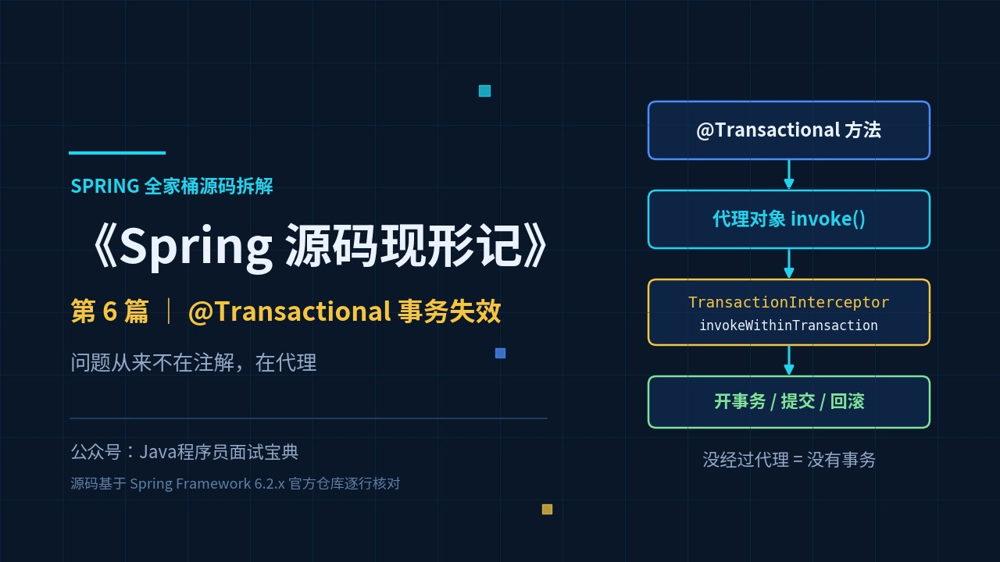
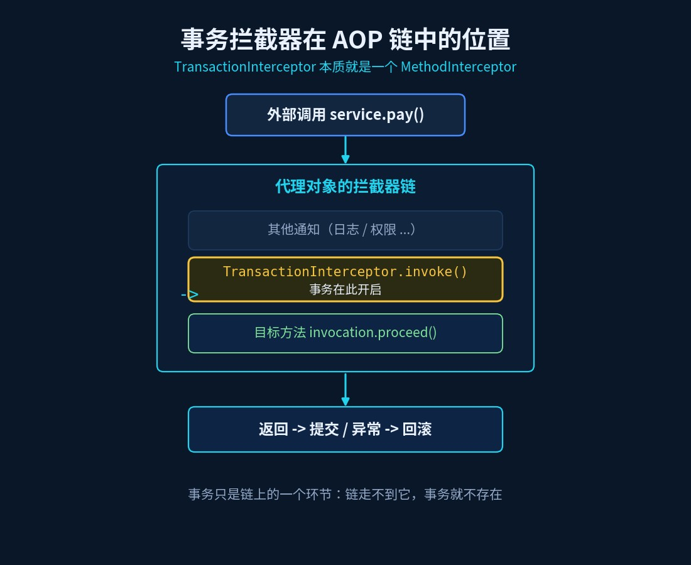
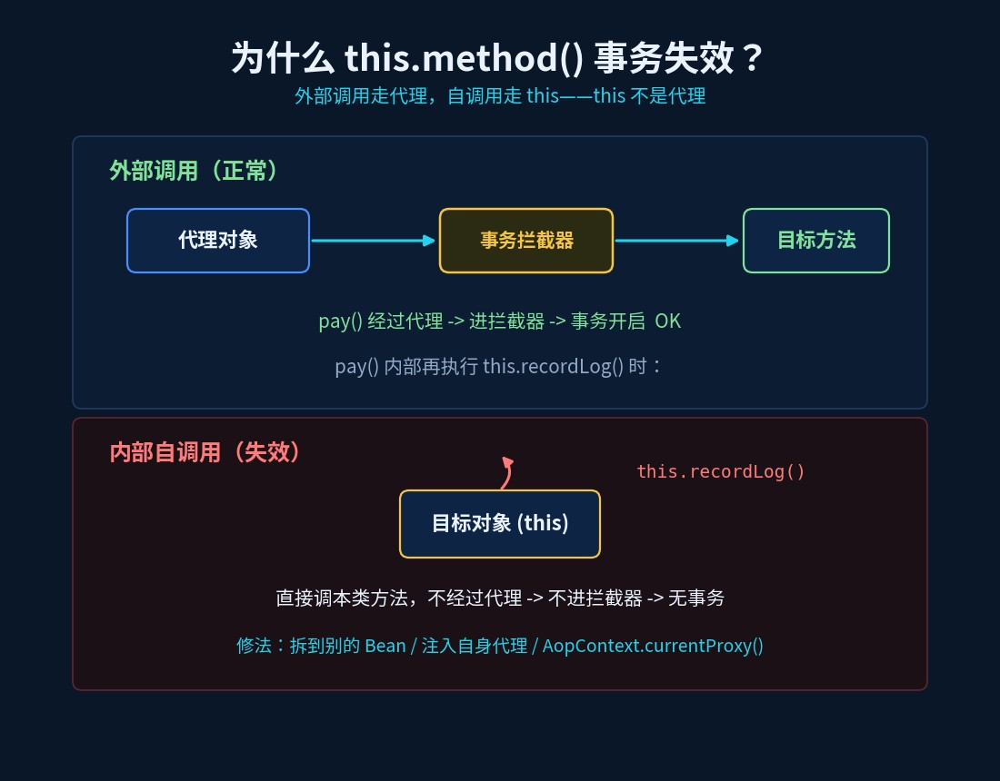
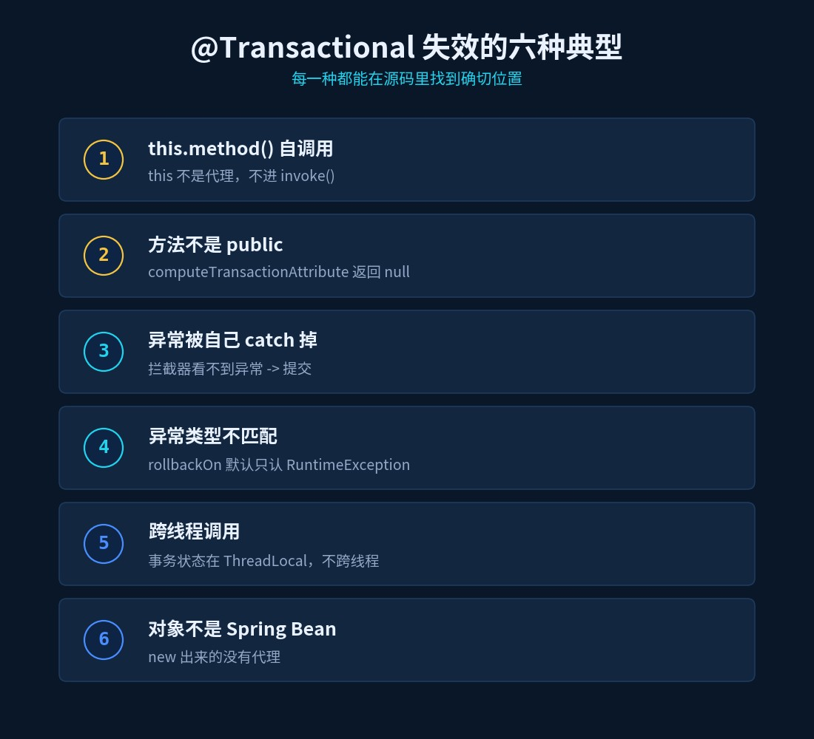
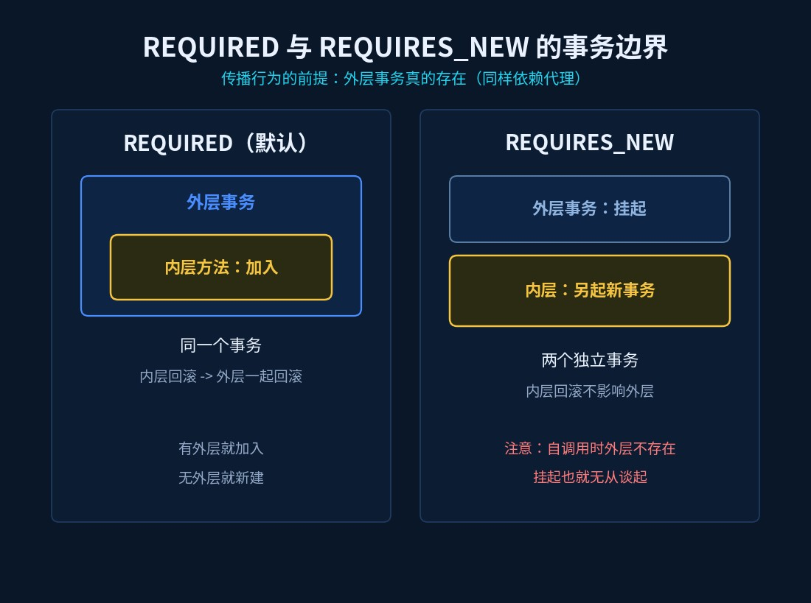

# @Transactional 事务失效：问题从来不在注解，在代理

> 《Spring 源码现形记》第 6 篇 ｜ 源码基于 Spring Framework 6.2.x 分支



## 一个天天在线上发生的场景

`OrderService` 里这样写：

```java
@Service
public class OrderService {

    public void pay(Long orderId) {
        this.recordLog(orderId);      // 自调用
    }

    @Transactional(rollbackFor = Exception.class)
    public void recordLog(Long orderId) {
        // 写日志 + 改订单状态
        if (xxx) throw new IllegalStateException("写日志失败");
    }
}
```

结果：`recordLog` 抛了异常，**但它的事务根本没回滚**，日志脏数据留在库里。

面试官这时候不会问"`@Transactional` 有哪些属性"，他会问一句更狠的：

> "你说是注解没生效——那你说说，**注解是在哪里被读到的**？为什么这个方法读不到？"

答不上来，就说明你只会用，没看过源码。

## 旧问法 vs 新问法

| 旧问法（背就完事） | 新问法（要真读过源码） |
|---|---|
| `@Transactional` 有哪些属性？ | 事务逻辑是**谁**在什么时机执行的？ |
| 事务失效有哪些原因？ | 自调用为什么失效——**失效在源码的哪一行**？ |
| 受检异常默认回滚吗？ | `rollbackOn()` 的默认实现是哪一行？ |
| `REQUIRES_NEW` 是什么？ | 它要生效，**为什么也依赖代理**？ |

## 一、先认清：`@Transactional` 就是一个 AOP 通知

这是全篇的钥匙，也是篇5 的伏笔回收。

你写 `@EnableTransactionManagement`（Spring Boot 里自动加了），它会导入 `ProxyTransactionManagementConfiguration`，注册两个基础设施 Bean（6.2.x）：

```java
@Bean(name = TransactionManagementConfigUtils.TRANSACTION_ADVISOR_BEAN_NAME)
public BeanFactoryTransactionAttributeSourceAdvisor transactionAdvisor(
        TransactionAttributeSource transactionAttributeSource,
        TransactionInterceptor transactionInterceptor) { ... }

@Bean
public TransactionInterceptor transactionInterceptor(TransactionAttributeSource transactionAttributeSource) { ... }
```

一个 **Advisor**（切面），一个 **Advice**（通知）。而这个通知的真身，看类声明就懂了：

```java
public class TransactionInterceptor extends TransactionAspectSupport
        implements MethodInterceptor, Serializable {

    @Override
    public Object invoke(MethodInvocation invocation) throws Throwable {
        Class<?> targetClass = (invocation.getThis() != null ?
                AopUtils.getTargetClass(invocation.getThis()) : null);
        return invokeWithinTransaction(invocation.getMethod(), targetClass, invocation::proceed);
    }
}
```

看到了吗——`TransactionInterceptor` 就是一个 `MethodInterceptor`，和你在篇5 里见过的 AOP 通知**是同一类东西**。它挂进拦截器链，方法被调用时才有机会执行。注意最后那个 `invocation::proceed`：篇5 讲的 `proceed()` 递归，这里原封不动地用上了。

**一句话结论：事务必须由代理拦截，没有代理就没有事务。** 后面所有"失效"，都是这一句话的变体。



## 二、事务的"生命线"：`invokeWithinTransaction`

真正的核心逻辑在 `TransactionAspectSupport.invokeWithinTransaction`（6.2.x，去掉响应式分支后）：

```java
protected Object invokeWithinTransaction(Method method, Class<?> targetClass,
        InvocationCallback invocation) throws Throwable {

    TransactionAttributeSource tas = getTransactionAttributeSource();
    TransactionAttribute txAttr = (tas != null ? tas.getTransactionAttribute(method, targetClass) : null);

    TransactionInfo txInfo = createTransactionIfNecessary(ptm, txAttr, joinpointIdentification); // ① 开事务

    Object retVal;
    try {
        retVal = invocation.proceedWithInvocation();   // ② 执行目标方法
    }
    catch (Throwable ex) {
        completeTransactionAfterThrowing(txInfo, ex);  // ③ 异常 → 判断是否回滚
        throw ex;
    }
    commitTransactionAfterReturning(txInfo);           // ④ 正常返回 → 提交
    return retVal;
}
```

就四步：**拿属性 → 开事务 → 执行 → 提交/回滚**。

把它当"生命线"看：**这四步里任何一步没走到，事务就会表现异常**。下面六种典型失效，全部能对到具体某一步或某个前置条件上。

## 三、失效六种典型，逐个对源码

### 1. `this.method()` 自调用——代理根本没参与

```java
public void pay(Long orderId) {
    this.recordLog(orderId);   // 走的是 this，不是代理对象
}
```

你注入进来的 `OrderService` 是**代理对象**，但类里的 `this` 指向的是**目标对象本身**。`this.recordLog()` 是一次普通的 Java 方法调用，**根本不经过 `TransactionInterceptor.invoke`**——第 ① 步就没了，何谈事务。

这就是"自调用失效"的源码级解释，也是篇5 `proceed()` 那段的自然结论：**只有经过代理的调用，才能进拦截器链**。



修法：把它拆到另一个 Bean 里互相调用；或者注入自己（`@Lazy` 注入 `OrderService` 代理）；或者用 `AopContext.currentProxy()`。

### 2. 方法不是 `public`——属性直接被判 `null`

`AbstractFallbackTransactionAttributeSource.computeTransactionAttribute` 的第一行就是答案：

```java
protected TransactionAttribute computeTransactionAttribute(Method method, Class<?> targetClass) {
    // Don't allow non-public methods, as configured.
    if (allowPublicMethodsOnly() && !Modifier.isPublic(method.getModifiers())) {
        return null;          // ← 非 public，直接判定"不是事务方法"
    }
    ...
}
```

而默认实现是返回 **true** 的——`AnnotationTransactionAttributeSource` 里 `private boolean publicMethodsOnly = true;`，`allowPublicMethodsOnly()` 就返回它。

所以：**`@Transactional` 写在 `private` / `protected` / 包级方法上，等于没写**——属性为 `null`，压根不算事务方法。（顺带：CGLIB 也只覆写可继承的方法，非 public 的本来就代理不了，双重失效。）

### 3. 异常被你 catch 掉了——拦截器"看不见"

```java
try {
    recordLog(orderId);
} catch (Exception e) {
    log.error("失败", e);   // 吞掉了，没往外抛
}
```

拦截器的第 ③ 步只在 `catch (Throwable ex)` 里触发。你把异常吞了，方法"正常返回"，于是走到第 ④ 步——**提交**。

### 4. 异常类型不匹配——受检异常默认不回滚

再看 `completeTransactionAfterThrowing` 的判定：

```java
if (txInfo.transactionAttribute != null && txInfo.transactionAttribute.rollbackOn(ex)) {
    txInfo.getTransactionManager().rollback(txInfo.getTransactionStatus());   // 回滚
}
else {
    txInfo.getTransactionManager().commit(txInfo.getTransactionStatus());     // 不匹配 → 照样提交
}
```

关键在 `rollbackOn` 的**默认实现**（`DefaultTransactionAttribute`）：

```java
public boolean rollbackOn(Throwable ex) {
    return (ex instanceof RuntimeException || ex instanceof Error);
}
```

**默认只回滚 `RuntimeException` 和 `Error`**。你抛一个受检的 `IOException`，`rollbackOn` 返回 false → 走 `commit` → 事务"没回滚"。想让受检异常也回滚，必须写 `@Transactional(rollbackFor = Exception.class)`。

### 5. 事务上下文不跨线程

Spring 把当前事务状态放在 `ThreadLocal`（`TransactionSynchronizationManager`）里。你在 `@Transactional` 方法里 **new 一个线程**去调后续逻辑，新线程拿不到外层事务，自然不受它管辖。

### 6. 对象不是 Spring Bean

`new OrderService()` 出来的对象，不在容器里，也没有代理——第 ①步到第 ④ 步一次都不会执行。



## 四、`REQUIRED` vs `REQUIRES_NEW`：也绕不开代理

| | `REQUIRED`（默认） | `REQUIRES_NEW` |
|---|---|---|
| 外层已有事务 | **加入**外层事务 | **挂起**外层，另起新事务 |
| 外层无事务 | 新建一个 | 新建一个 |
| 回滚影响 | 与外层一起回滚 | 独立提交/回滚，互不影响 |

表格背下来很容易，但坑在这里：`REQUIRES_NEW` 要真的"挂起外层、另起新事务"，**前提是外层事务真的存在**。而如果你是在同一个类里 `this.method()` 调用它——外层事务因自调用压根没建立，"挂起"也就无从谈起，行为自然和你预期不符。

**又是一个"本质是代理失效"。**



## 速查表

| 现象 | 源码依据 |
|---|---|
| 自调用失效 | `this` 不是代理，不进 `TransactionInterceptor.invoke` |
| 非 public 失效 | `computeTransactionAttribute`：`!Modifier.isPublic` → 返回 `null` |
| 异常被 catch → 不回滚 | 只有 `catch (Throwable ex)` 才触发回滚逻辑 |
| 受检异常不回滚 | `DefaultTransactionAttribute.rollbackOn` 默认只认 `RuntimeException`/`Error` |
| 新线程里事务丢失 | 事务状态存在 `ThreadLocal`，不跨线程 |
| `new` 出来的对象无事务 | 不是 Bean，没有代理 |
| 事务管理入口 | `TransactionInterceptor.invoke` → `invokeWithinTransaction` |

## 动手验证（10 分钟）

1. 在 `TransactionInterceptor.invoke` 打断点，分别用"外部直接调用"和 `this.method()` 调用，看断点**是否命中**——自调用时它不会进来；
2. 把 `@Transactional` 从一个 `public` 方法挪到一个 `private` 方法上，在 `computeTransactionAttribute` 的第一行打断点，看它 `return null`；
3. 写一个抛 `IOException` 的方法，先只加 `@Transactional`（观察提交），再加 `rollbackFor = Exception.class`（观察回滚）；
4. 用 `AopContext.currentProxy()` 修好自调用，对比日志里"是否回滚"的差别。

## 下一篇预告

事务是 AOP 通知的一种，那 Spring MVC 呢？一个 HTTP 请求从 Servlet 容器进来，`DispatcherServlet` 是怎么把它一步步派发到你的 `@Controller` 方法上的？下一篇：《Spring MVC 请求全链路：doDispatch 到底做了什么》。
