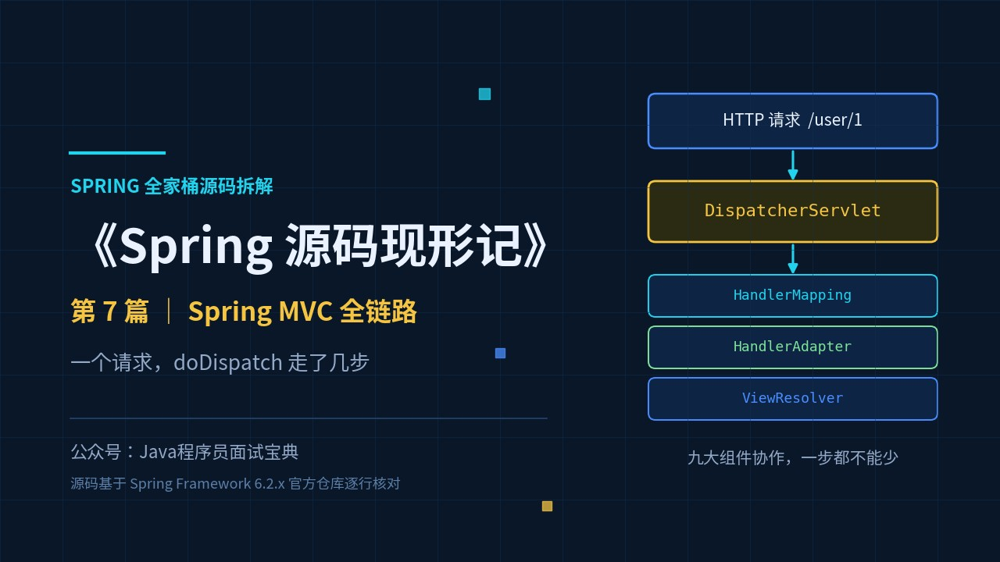
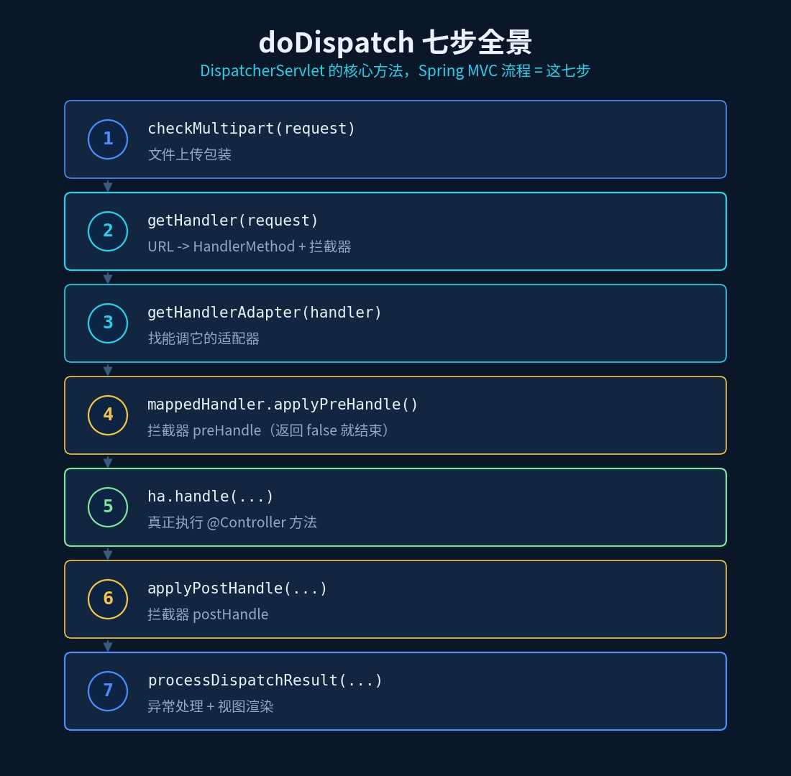
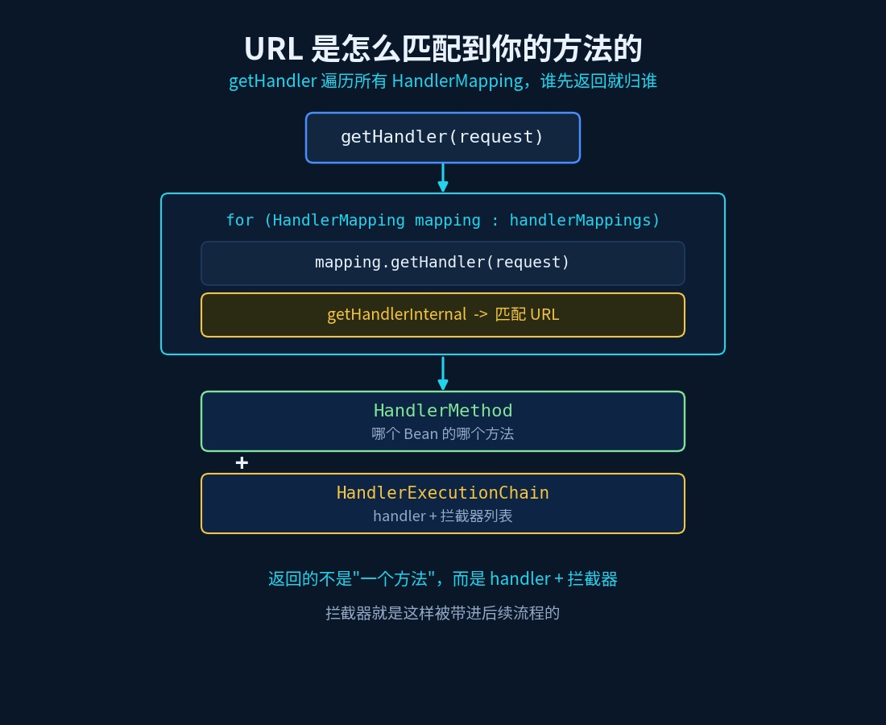
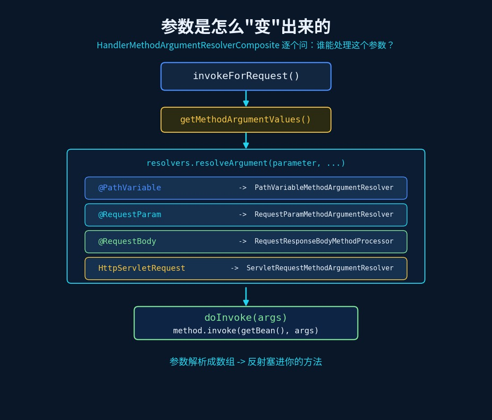
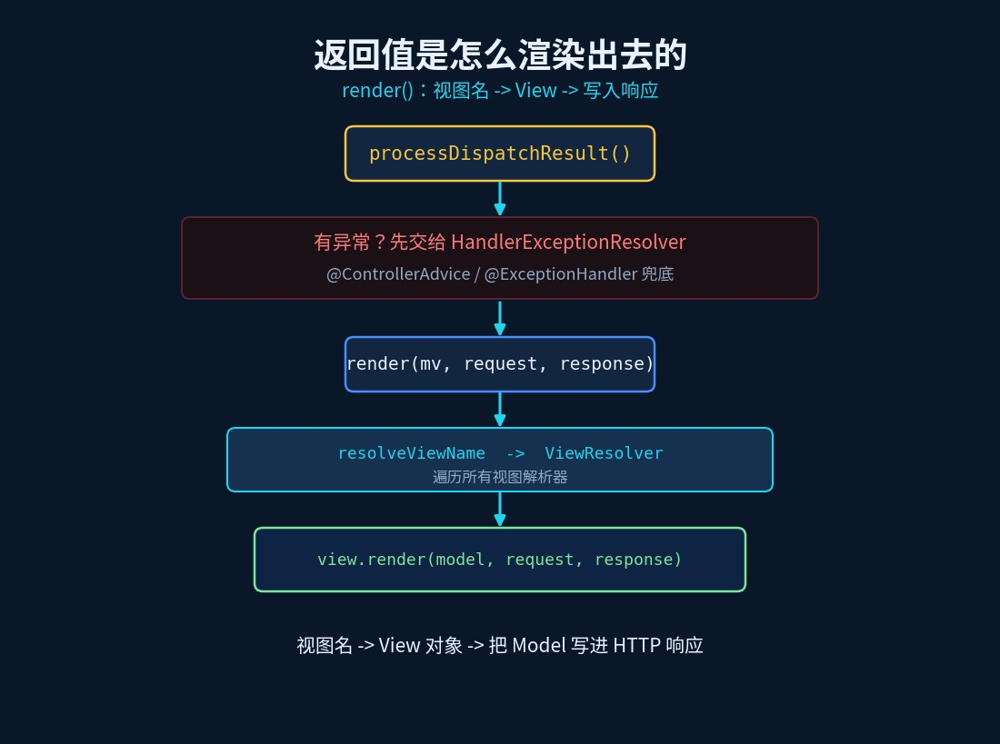

# Spring MVC 请求全链路：doDispatch 到底做了什么

> 《Spring 源码现形记》第 7 篇 ｜ 源码基于 Spring Framework 6.2.x 分支



## 一个天天在用、却没人说得清的流程

你写了一个 `@Controller`：

```java
@RestController
public class UserController {
    @GetMapping("/user/{id}")
    public User get(@PathVariable Long id, @RequestParam String type) { ... }
}
```

浏览器一访问 `/user/1?type=vip`，方法就执行了。可面试官问：

> "从一个 HTTP 请求进 Tomcat，到你的方法被执行、返回值变成 JSON——**中间发生了哪几步？参数是怎样从 URL 里"变"成方法参数的？**"

这题能答三句的人不少，能把它串成**一条完整的链路**的，不多。而这条链路的每一环，都写在 `DispatcherServlet.doDispatch` 里。

## 旧问法 vs 新问法

| 旧问法（背就完事） | 新问法（要真读过源码） |
|---|---|
| Spring MVC 的执行流程？ | `doDispatch` 里到底有几步？先后顺序？ |
| 九大组件是什么？ | URL 是**谁**匹配到方法的？匹配结果是什么对象？ |
| `@RequestParam` 怎么绑定的？ | 参数解析**挨个问谁**？在哪里反射调用方法？ |
| 返回值怎么变成 JSON？ | `ModelAndView` 是怎么被渲染出去的？ |

## 一、总调度：DispatcherServlet 只有一个核心方法

**Spring MVC 的所有请求，都收敛到一个方法**：`DispatcherServlet.doDispatch`（6.2.x，去掉了 async/multipart 细节后）：

```java
protected void doDispatch(HttpServletRequest request, HttpServletResponse response) {
    processedRequest = checkMultipart(request);              // ① 文件上传包装
    mappedHandler = getHandler(processedRequest);            // ② 找 handler（+拦截器）
    if (mappedHandler == null) { noHandlerFound(...); return; }

    HandlerAdapter ha = getHandlerAdapter(mappedHandler.getHandler());  // ③ 找适配器

    if (!mappedHandler.applyPreHandle(processedRequest, response)) {    // ④ preHandle
        return;
    }
    mv = ha.handle(processedRequest, response, mappedHandler.getHandler()); // ⑤ 执行目标方法

    applyDefaultViewName(processedRequest, mv);
    mappedHandler.applyPostHandle(processedRequest, response, mv);          // ⑥ postHandle

    processDispatchResult(processedRequest, response, mappedHandler, mv, dispatchException); // ⑦ 渲染
}
```

就这七步。**"Spring MVC 流程"这道题，标准答案就是这七行。** 记住这七步，比背十篇博客都管用。



## 二、为什么说它是"总调度"：九大组件

`DispatcherServlet` 在初始化时会装配九个组件（`initStrategies`）：

| 组件 | 职责 |
|---|---|
| `MultipartResolver` | 文件上传（`checkMultipart`） |
| `HandlerMapping` | URL → handler（第 ② 步） |
| `HandlerAdapter` | 调 handler（第 ③⑤ 步） |
| `HandlerExceptionResolver` | 异常 → ModelAndView（第 ⑦ 步） |
| `ViewResolver` | 视图名 → View（第 ⑦ 步） |
| `HandlerMethodArgumentResolver` | 请求 → 方法参数（第 ⑤ 步内部） |
| `HandlerMethodReturnValueHandler` | 返回值 → 响应（第 ⑤ 步内部） |
| `LocaleResolver` / `ThemeResolver` / `RequestToViewNameTranslator` / `FlashMapManager` | 国际化 / 主题 / 默认视图名 / 重定向传参 |

注意一句：**DispatcherServlet 自己几乎不干活，它只负责"调度"**——每一步都委托给一个组件去完成。这就是"前端控制器（Front Controller）"模式的精髓。

## 三、第 ② 步：URL 是怎么匹配到你的方法的

`getHandler` 做的事很简单，就是**遍历所有 HandlerMapping，谁先返回就归谁**：

```java
protected HandlerExecutionChain getHandler(HttpServletRequest request) throws Exception {
    if (this.handlerMappings != null) {
        for (HandlerMapping mapping : this.handlerMappings) {
            HandlerExecutionChain handler = mapping.getHandler(request);
            if (handler != null) {
                return handler;
            }
        }
    }
    return null;
}
```

回到 `AbstractHandlerMapping.getHandler`：

```java
Object handler = getHandlerInternal(request);            // 用 URL 匹配到具体 handler
if (handler instanceof String handlerName) {
    handler = obtainApplicationContext().getBean(handlerName);
}
HandlerExecutionChain executionChain = getHandlerExecutionChain(handler, request);
```

`getHandlerInternal` 由子类 `RequestMappingHandlerMapping` 实现——它持有所有 `@RequestMapping` 方法的注册表，用 URL 路径 + 请求方法做匹配，匹配到的 **handler 是一个 `HandlerMethod`**（封装了"哪个 Bean 的哪个方法"）。

`getHandlerExecutionChain` 则把匹配到拦截器（`HandlerInterceptor`）**包进 `HandlerExecutionChain`**。所以返回的不是一个"方法"，而是 **handler + 拦截器列表**——这就是第 ④⑥ 步 `applyPreHandle`/`applyPostHandle` 能生效的原因。



## 四、第 ⑤ 步：参数是怎么"变"出来的

`ha.handle` 最终走到 `RequestMappingHandlerAdapter.invokeHandlerMethod`，核心是把 handler 包装成可调用的对象：

```java
ServletInvocableHandlerMethod invocableMethod = createInvocableHandlerMethod(handlerMethod);
if (this.argumentResolvers != null) {
    invocableMethod.setHandlerMethodArgumentResolvers(this.argumentResolvers);
}
if (this.returnValueHandlers != null) {
    invocableMethod.setHandlerMethodReturnValueHandlers(this.returnValueHandlers);
}
...
invocableMethod.invokeAndHandle(webRequest, mavContainer);
```

再往下就是 `InvocableHandlerMethod.invokeForRequest`，两步走：

```java
public Object invokeForRequest(NativeWebRequest request, ModelAndViewContainer mavContainer, Object... providedArgs) {
    Object[] args = getMethodArgumentValues(request, mavContainer, providedArgs);  // ① 解析参数
    ...
    Object returnValue = doInvoke(args);                                          // ② 反射调用
    return returnValue;
}
```

**① 解析参数**——对每个方法参数，挨个问"谁能处理它"：

```java
for (int i = 0; i < parameters.length; i++) {
    MethodParameter parameter = parameters[i];
    if (!this.resolvers.supportsParameter(parameter)) {
        throw new IllegalStateException(formatArgumentError(parameter, "No suitable resolver"));
    }
    args[i] = this.resolvers.resolveArgument(parameter, mavContainer, request, this.dataBinderFactory);
}
```

`this.resolvers` 是一个 `HandlerMethodArgumentResolverComposite`，内部持有**几十个参数解析器**，挨个问 `supportsParameter`：

- `@PathVariable` → `PathVariableMethodArgumentResolver`
- `@RequestParam` → `RequestParamMethodArgumentResolver`
- `@RequestBody` → `RequestResponseBodyMethodProcessor`
- `HttpServletRequest` 等原生类型 → `ServletRequestMethodArgumentResolver`

**② 反射调用**——解析出的参数数组，最终通过反射"塞"进你的方法：

```java
protected Object doInvoke(Object... args) throws Exception {
    Method method = getBridgedMethod();
    return method.invoke(getBean(), args);   // 就是这一行，执行了你的 @Controller 方法
}
```

所以"参数怎么来的"的完整答案是：**`HandlerMethodArgumentResolver` 逐个解析出参数数组 → 反射 `method.invoke` 调用目标方法**。



## 五、第 ⑦ 步：返回值是怎么渲染出去的

方法执行完，可能返回 `ModelAndView`（或经 `ReturnValueHandler` 转成响应）。若还有视图要渲染，走到 `processDispatchResult` → `render`：

```java
protected void render(ModelAndView mv, HttpServletRequest request, HttpServletResponse response) {
    Locale locale = (this.localeResolver != null ? this.localeResolver.resolveLocale(request) : request.getLocale());
    response.setLocale(locale);

    View view;
    String viewName = mv.getViewName();
    if (viewName != null) {
        view = resolveViewName(viewName, mv.getModelInternal(), locale, request);   // 视图名 -> View
    } else {
        view = mv.getView();
    }
    ...
    view.render(mv.getModelInternal(), request, response);    // 委托 View 渲染
}
```

两步：**`ViewResolver` 把视图名解析成 `View` 对象 → `view.render(model, request, response)` 把 Model 写进响应**。

另外——如果第 ⑤ 步抛了异常，`processDispatchResult` 会先交给 `processHandlerException`（遍历 `HandlerExceptionResolver`），给你的 `@ExceptionHandler` 一个接管的机会。这就是 `@ControllerAdvice + @ExceptionHandler` 能兜底的原因。



## 速查表

| 问题 | 答案（源码依据） |
|---|---|
| 请求总入口 | `DispatcherServlet.doDispatch`（七步） |
| 怎么找 handler | `getHandler` 遍历 `handlerMappings` → `mapping.getHandler(request)` |
| 匹配结果是什么 | `HandlerExecutionChain` = `HandlerMethod` + 拦截器列表 |
| 怎么找适配器 | `getHandlerAdapter` 遍历 `handlerAdapters` → `adapter.supports(handler)` |
| 真正执行方法在哪 | `InvocableHandlerMethod.doInvoke` → `method.invoke(getBean(), args)` |
| 参数怎么绑定 | `HandlerMethodArgumentResolverComposite.resolveArgument` 逐个解析 |
| 返回值怎么处理 | `HandlerMethodReturnValueHandler`；异常走 `HandlerExceptionResolver` |
| 视图怎么渲染 | `render` → `ViewResolver` 解析 → `view.render(...)` |
| 拦截器在哪触发 | `mappedHandler.applyPreHandle` / `applyPostHandle` / `triggerAfterCompletion` |

## 动手验证（10 分钟）

1. 在 `doDispatch` 打断点，访问任意接口，单步走完七步，看每一步的变量（`mappedHandler`、`ha`、`mv`）；
2. 在 `getHandler` 的 for 循环里看 `handlerMappings` 里有哪几个实现（`RequestMappingHandlerMapping`、`SimpleUrlHandlerMapping`...）；
3. 在 `getMethodArgumentValues` 里看你的方法参数被哪个 `resolver` 处理（断点 `supportsParameter`）；
4. 在 `doInvoke` 的 `method.invoke` 上打断点——那一刻，你的 `@GetMapping` 方法刚开始执行。

## 下一篇预告

MVC 全链路里，`HandlerMapping`、`HandlerAdapter` 这些组件**是谁帮你装进 DispatcherServlet 的**？答案只有四个字：自动配置。下一篇：《Spring Boot 自动配置原理：@ConditionalOnMissingBean 到底"少"了什么》。
