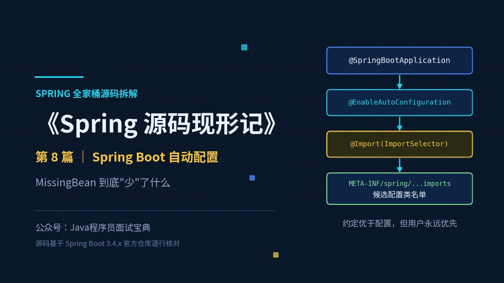
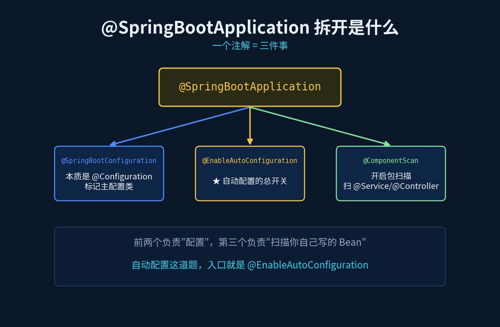
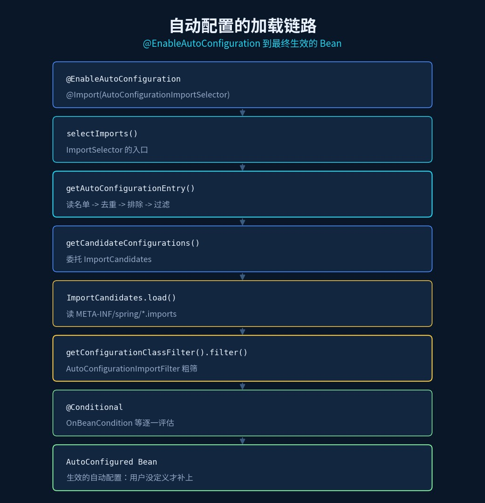
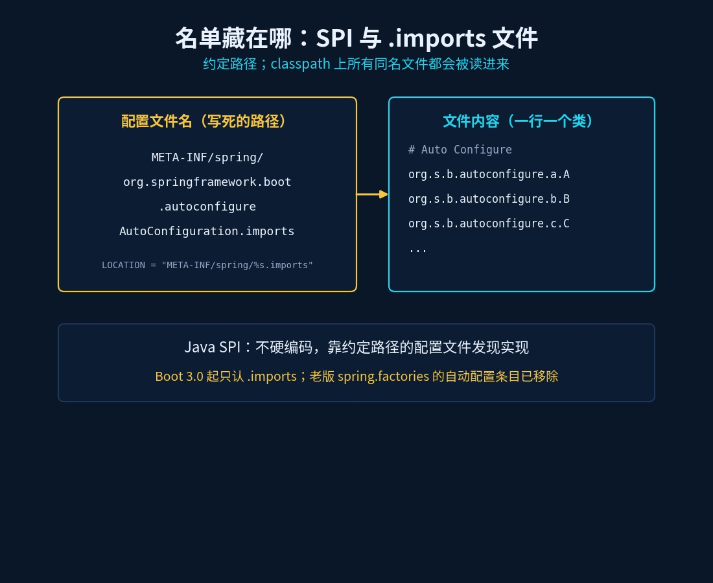
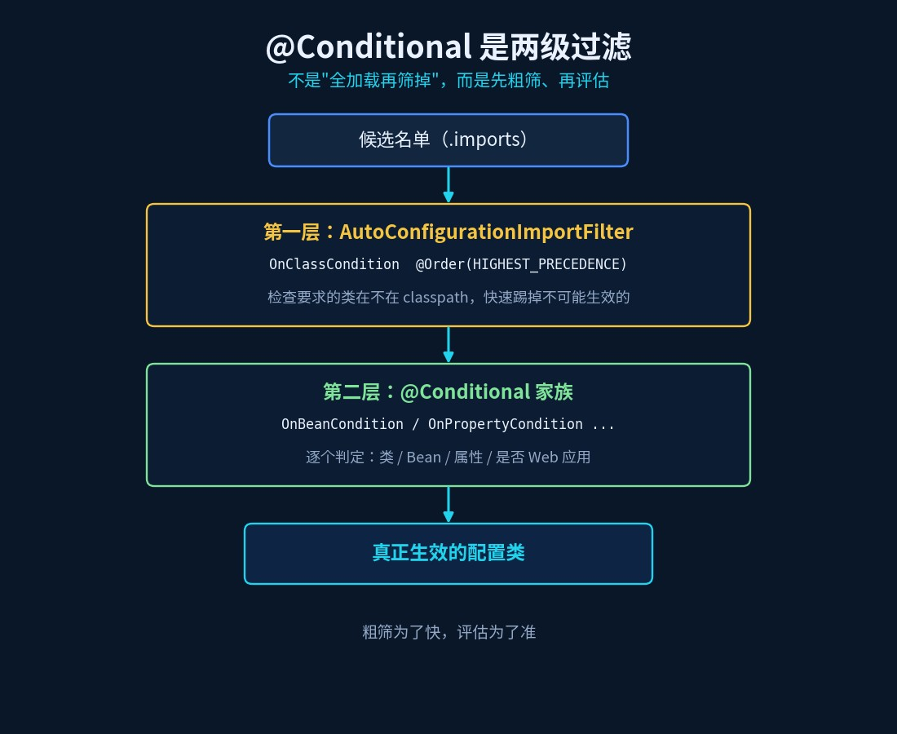

# Spring Boot 自动配置原理：@ConditionalOnMissingBean 到底"少"了什么

> 《Spring 源码现形记》第 8 篇 ｜ 源码基于 Spring Boot 3.4.x 分支



## 一道几乎必问的题

面试官："Spring Boot 为什么能'开箱即用'？你什么都没配，`DataSource`、`Tomcat` 怎么就都好了？"

你："因为**自动配置**。"

面试官："那我再问一句——**自动配置的类是哪里来的？它怎么知道该配哪些？如果我自己定义了一个 `DataSource`，它怎么办？**"

三连问下来，能答全的人不多。尤其是最后一句，藏着 Spring Boot 最精髓的设计：**约定优于配置，但用户永远优先。**

## 旧问法 vs 新问法

| 旧问法（背就完事） | 新问法（要真读过源码） |
|---|---|
| `@SpringBootApplication` 是什么？ | 它其实是**哪三个注解**的组合？ |
| 自动配置原理？ | 那些配置类的**名单**存在哪个文件里？谁读的？ |
| `@ConditionalOnMissingBean` 干嘛的？ | 它凭什么保证"用户自定义优先"？ |
| `@Conditional` 什么时候生效？ | 自动配置是不是"先全加载再筛掉"？ |

## 一、先拆第一个字：`@SpringBootApplication` 是三个注解

翻开源码（3.4.x），它长这样：

```java
@Target(ElementType.TYPE)
@Retention(RetentionPolicy.RUNTIME)
@SpringBootConfiguration
@EnableAutoConfiguration
@ComponentScan(excludeFilters = { @Filter(type = FilterType.CUSTOM, classes = TypeExcludeFilter.class),
        @Filter(type = FilterType.CUSTOM, classes = AutoConfigurationExcludeFilter.class) })
public @interface SpringBootApplication {
    ...
}
```

拆开就是三件事：

- **`@SpringBootConfiguration`**：本质是 `@Configuration`，标记"这是主配置类"；
- **`@ComponentScan`**：开启包扫描（扫你写的 `@Service`/`@Controller`）；
- **`@EnableAutoConfiguration`**：★ **自动配置的总开关**。

所以"自动配置"这道题的入口，就是 `@EnableAutoConfiguration`。



## 二、`@EnableAutoConfiguration` 只做了一件事：`@Import`

再往里看，它本身也没几行：

```java
@Target(ElementType.TYPE)
@Retention(RetentionPolicy.RUNTIME)
@Inherited
@AutoConfigurationPackage
@Import(AutoConfigurationImportSelector.class)
public @interface EnableAutoConfiguration {
    String ENABLED_OVERRIDE_PROPERTY = "spring.boot.enableautoconfiguration";
    Class<?>[] exclude() default {};
    String[] excludeName() default {};
}
```

关键就是 `@Import(AutoConfigurationImportSelector.class)`——把自动配置的**选择工作**交给了一个 `ImportSelector`。（Spring 的 `@Import` 有三种用法：导入类、导入 `ImportSelector`、导入 `ImportBeanDefinitionRegistrar`。这里是第二种。）

`AutoConfigurationImportSelector` 的核心方法叫 `selectImports`——**它返回的字符串数组，就是"要导入哪些配置类"的答案。**

## 三、名单从哪来：`.imports` 文件（SPI 机制）

`selectImports` 往下走到 `getAutoConfigurationEntry`，四步（3.4.x）：

```java
protected AutoConfigurationEntry getAutoConfigurationEntry(AnnotationMetadata annotationMetadata) {
    if (!isEnabled(annotationMetadata)) { return EMPTY_ENTRY; }
    AnnotationAttributes attributes = getAttributes(annotationMetadata);
    List<String> configurations = getCandidateConfigurations(annotationMetadata, attributes); // ① 读名单
    configurations = removeDuplicates(configurations);                                        // ② 去重
    Set<String> exclusions = getExclusions(annotationMetadata, attributes);                    // ③ 排除
    configurations.removeAll(exclusions);
    configurations = getConfigurationClassFilter().filter(configurations);                    // ④ 过滤
    fireAutoConfigurationImportEvents(configurations, exclusions);
    return new AutoConfigurationEntry(configurations, exclusions);
}
```

**① 读名单** —— `getCandidateConfigurations` 委托给 `ImportCandidates`：

```java
protected List<String> getCandidateConfigurations(AnnotationMetadata metadata, AnnotationAttributes attributes) {
    ImportCandidates importCandidates = ImportCandidates.load(this.autoConfigurationAnnotation, getBeanClassLoader());
    List<String> configurations = importCandidates.getCandidates();
    Assert.notEmpty(configurations, "No auto configuration classes found in META-INF/spring/" + ... + ".imports...");
    return configurations;
}
```

`ImportCandidates` 的 LOCATION 写死了一行：

```java
private static final String LOCATION = "META-INF/spring/%s.imports";
```

把注解全名代进去，就是那个**鼎鼎大名的文件**：

```
META-INF/spring/org.springframework.boot.autoconfigure.AutoConfiguration.imports
```

`ImportCandidates.load` 做的事很朴素：**从 classpath 上把**这个文件（可能有多份，比如每个 starter 的 jar 里各有一份）**全部读出来**，一行一个类的全限定名（`#` 开头的行是注释），拼成一个候选列表。

这就是 Java 的 **SPI（Service Provider Interface）机制**——**不硬编码，靠约定路径的配置文件发现实现**。

> 划重点：**Boot 3.0 起，自动配置的名单只认 `.imports` 文件**。老版本写在 `META-INF/spring.factories` 里的 `EnableAutoConfiguration=` 那段，已经被移除了。





## 四、名单有了，为什么还会有"不生效"的配置类

上面第 ④ 步那个 `filter`——**自动配置从来不是"全加载再筛掉"，而是先快速预过滤，再真正评估。**

**第一层：`AutoConfigurationImportFilter`（导入前的快速过滤）**

`AutoConfigurationImportSelector` 内部持有一组 `AutoConfigurationImportFilter`，先对候选名单做一次"粗筛"，把明显不可能生效的类先踢掉。最典型的是 `OnClassCondition`：

```java
@Order(Ordered.HIGHEST_PRECEDENCE)
class OnClassCondition extends FilteringSpringBootCondition {
    @Override
    protected final ConditionOutcome[] getOutcomes(String[] autoConfigurationClasses, ...) {
        // 检查每个自动配置类要求的类是否在 classpath 上，多线程加速
    }
}
```

**它的作用**：如果 `DataSourceAutoConfiguration` 要求 classpath 上有 `javax.sql.DataSource`，而你根本没引数据库依赖——这一层就把它过滤掉了，**根本不会去解析它**。（这也是为什么 Boot 启动时能"忽略"你没用到的配置类。）

**第二层：`@Conditional` 家族（真正决定生效与否）**

通过粗筛的配置类，最后还要由 `@Conditional` 逐一评估。Spring Boot 提供了一大批：

| 注解 | 含义 |
|---|---|
| `@ConditionalOnClass` | classpath 上有指定类才生效 |
| `@ConditionalOnMissingClass` | 没有指定类才生效 |
| `@ConditionalOnBean` | 容器里有指定 Bean 才生效 |
| **`@ConditionalOnMissingBean`** | **容器里没有指定 Bean 才生效** |
| `@ConditionalOnProperty` | 配置属性满足条件才生效 |
| `@ConditionalOnWebApplication` | 是 Web 应用才生效 |



## 五、核心：`@ConditionalOnMissingBean`"少"了什么

这是本篇的题眼。`@ConditionalOnMissingBean` 由 `OnBeanCondition` 实现，看它的匹配逻辑（3.4.x）：

```java
private ConditionOutcome evaluateConditionalOnMissingBean(Spec<ConditionalOnMissingBean> spec, ConditionMessage matchMessage) {
    MatchResult matchResult = getMatchingBeans(spec);      // 去容器里找有没有这个类型的 Bean
    if (matchResult.isAnyMatched()) {
        return ConditionOutcome.noMatch(...);              // 找到了 → 条件不成立 → 自动配置让路
    }
    return ConditionOutcome.match(...);                    // 没找到 → 条件成立 → 自动配置上场
}
```

`getMatchingBeans` 直接从 `ConfigurableListableBeanFactory` 里按类型查。

**它"少"的，就是"一个你已经自己定义好的 Bean"。** 逻辑一句话：

> **自动配置想给你一个 `DataSource`，但它先问："容器里有 `DataSource` 了吗？"——有，说明你自己配了，那我就不插手；没有，我才补上。**

而且 `OnBeanCondition.getConfigurationPhase()` 返回的是 `ConfigurationPhase.REGISTER_BEAN`——**它在 Bean 注册阶段评估，不是解析阶段**。再加上一条铁律：**自动配置永远在用户定义的 Bean 之后处理**（`@EnableAutoConfiguration` 的 javadoc 原话：*Auto-configuration is always applied after user-defined beans have been registered.*）。

两条合起来，就是 Spring Boot 的"用户优先"：

- 你**没定义** → 自动配置补一个（开箱即用）；
- 你**定义了** → `@ConditionalOnMissingBean` 不匹配，自动配置退出（把你的配置还给你）。

**这就是为什么你只要写一个自己的 `@Bean DataSource`，Spring Boot 就"自动让位"——不是它聪明，是它在源码里先问了一句"有没有"。**

## 速查表

| 问题 | 答案（源码依据） |
|---|---|
| `@SpringBootApplication` 是什么 | `@SpringBootConfiguration` + `@EnableAutoConfiguration` + `@ComponentScan` |
| 自动配置入口 | `@EnableAutoConfiguration` → `@Import(AutoConfigurationImportSelector.class)` |
| 名单从哪读 | `ImportCandidates.load` 读 `META-INF/spring/xxx.AutoConfiguration.imports` |
| 候选名单处理 | `getAutoConfigurationEntry`：读名单 → 去重 → 排除 → 过滤 |
| 为什么没用到的没生效 | 第一层 `AutoConfigurationImportFilter`（`OnClassCondition` 等）粗筛 |
| 真正的生效判定 | 第二层 `@Conditional` 家族（`OnBeanCondition` 等） |
| `@ConditionalOnMissingBean` | `getMatchingBeans` 查容器，有则 noMatch → 用户定义优先 |
| 为什么"用户优先" | 自动配置在用户 Bean 之后处理 + 注册阶段评估 |
| `@AutoConfiguration` | `@Configuration(proxyBeanMethods = false)` + `@AutoConfigureBefore/@After` |

## 动手验证（10 分钟）

1. 在 `AutoConfigurationImportSelector.getAutoConfigurationEntry` 的 ④ 那行打断点，看 `configurations` 过滤前后**长度变化**（一眼看出筛掉了多少）；
2. 反编译你的一个 starter jar，找到 `META-INF/spring/org.springframework.boot.autoconfigure.AutoConfiguration.imports`，看里面列了哪些配置类；
3. 自己写一个 `@Bean DataSource`，在 `evaluateConditionalOnMissingBean` 打断点——看它 `noMatch` 的那一瞬间；
4. 加 `debug=true` 启动，控制台会打印 `Auto-configuration report`，Positive/Negative matches 一目了然。

## 下一篇预告

自动配置讲完了。但 Spring 里还有一堆"钩子"——`BeanPostProcessor`、`BeanFactoryPostProcessor`、`ApplicationListener`……它们到底在**什么时机**被调用？谁先谁后？下一篇：《Spring 扩展点全景：BFP 和 BP 差一个字，差了一个世界》。
