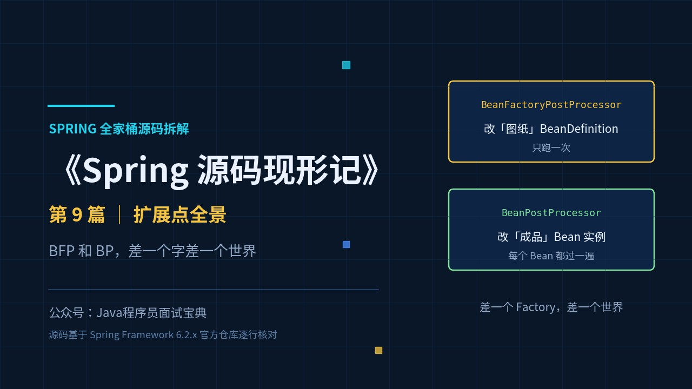
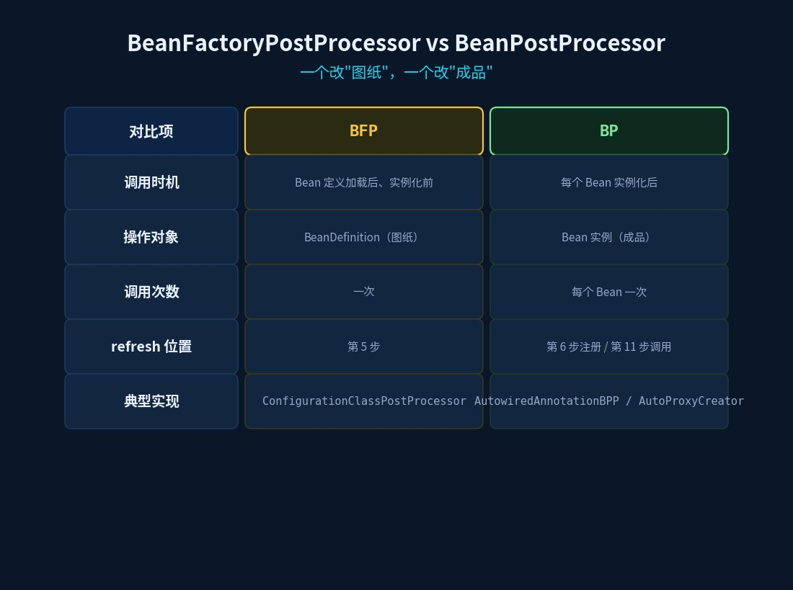
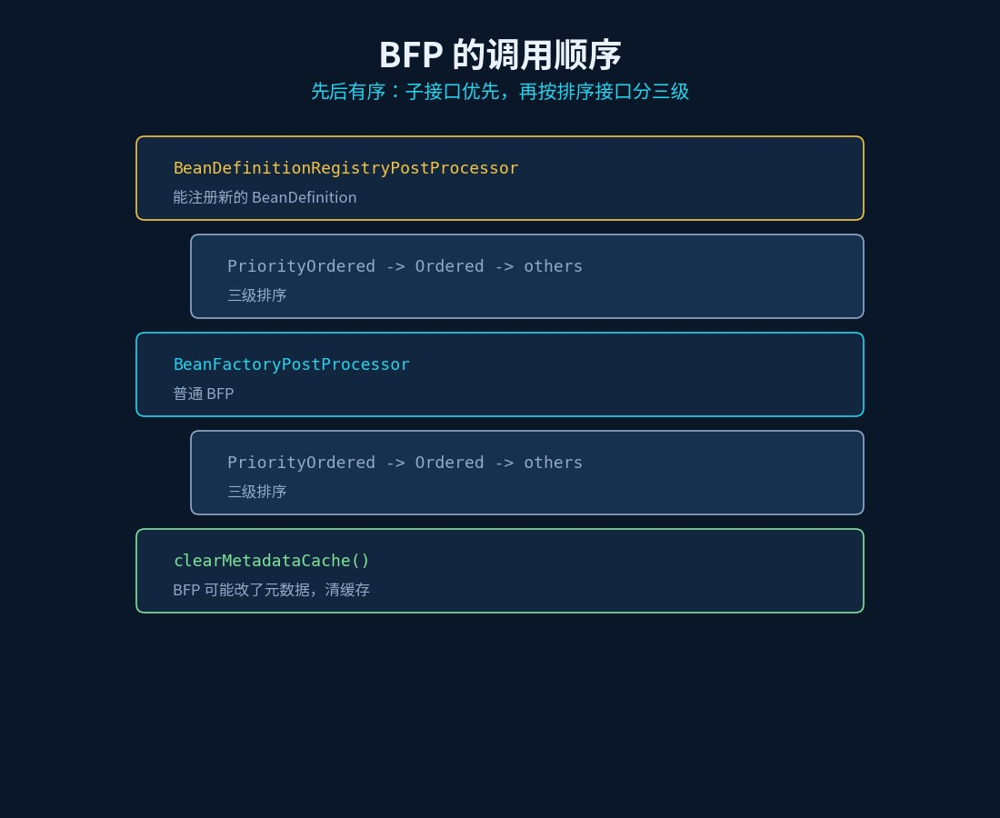
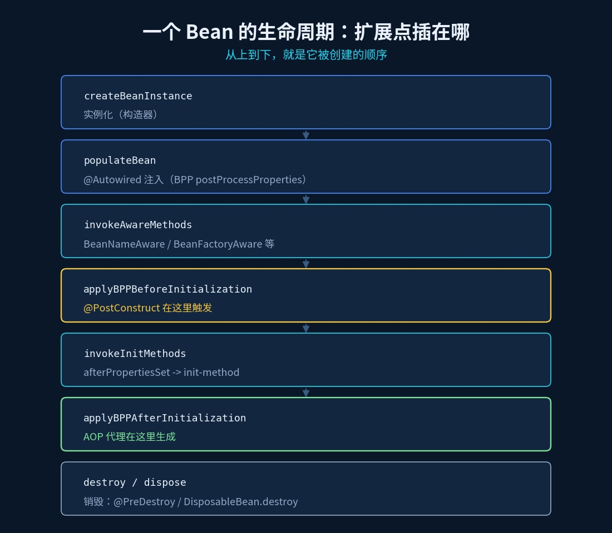
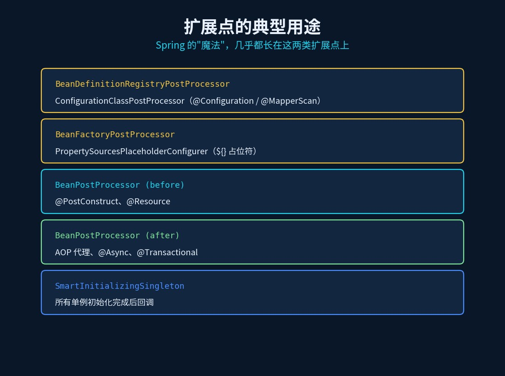

# Spring 扩展点全景：BFP 和 BP 差一个字，差了一个世界

> 《Spring 源码现形记》第 9 篇 ｜ 源码基于 Spring Framework 6.2.x 分支



## 一道"背了也白背"的题

面试官："Spring 有哪些扩展点？"

候选人："`BeanPostProcessor`、`BeanFactoryPostProcessor`、`ApplicationListener`、`InitializingBean`……"

面试官："停。`BeanPostProcessor` 和 `BeanFactoryPostProcessor` 名字差一个词，它俩**在什么时机被调用？谁先谁后？**"

候选人：……

这两个接口，名字只差一个 `Factory`，但**打交道的对象完全不同**：一个管"图纸"，一个管"成品"。搞不清这一点，所有扩展点知识都是散的。

## 旧问法 vs 新问法

| 旧问法（背就完事） | 新问法（要真读过源码） |
|---|---|
| BFP 和 BP 有什么区别？ | 它们在 `refresh()` 的**第几步**被调用？ |
| BP 什么时候执行？ | `initializeBean` 里它插在**哪个位置**？ |
| `@PostConstruct` 谁触发的？ | 它在 BPP 的 before 还是 after？ |
| AOP 代理在哪一步生成？ | BPP 的哪一环？为什么它在最后？ |

## 一、一句话分清：图纸 vs 成品

- **`BeanFactoryPostProcessor`（BFP）**：在**所有 Bean 定义（BeanDefinition）都加载完、但还没有实例化任何 Bean 之前**运行。它操作的是**"图纸"**——可以改 `BeanDefinition`（改属性、改 scope）。典型：`ConfigurationClassPostProcessor`（解析 `@Configuration`/`@ComponentScan`/`@Import`）、`PropertySourcesPlaceholderConfigurer`。
- **`BeanPostProcessor`（BP）**：在**每个 Bean 实例化出来之后**运行。它操作的是**"成品"**——可以包装、替换、代理 Bean 实例。典型：`AutowiredAnnotationBeanPostProcessor`（处理 `@Autowired` 注入）、`CommonAnnotationBeanPostProcessor`（`@PostConstruct`）、`AbstractAutoProxyCreator`（生成 AOP 代理）。

**一句话**：BFP 改"图纸"，只有一次机会；BP 改"成品"，每个 Bean 都要过一遍。



## 二、时机：全在 `refresh()` 里（承接篇1）

回到 `AbstractApplicationContext.refresh()`（6.2.x），把两个扩展点的调用点标出来：

```java
public void refresh() {
    prepareRefresh();                          // 1 准备
    ConfigurableListableBeanFactory beanFactory = obtainFreshBeanFactory();  // 2 建/刷新工厂
    prepareBeanFactory(beanFactory);           // 3 准备工厂

    postProcessBeanFactory(beanFactory);       // 4 子类扩展

    invokeBeanFactoryPostProcessors(beanFactory);   // ★ 5 调用 BFP  ← 图纸改造在这
    registerBeanPostProcessors(beanFactory);        // ★ 6 注册 BP  ← 把成品加工器装好

    initMessageSource();                       // 7
    initApplicationEventMulticaster();         // 8
    onRefresh();                               // 9
    registerListeners();                       // 10

    finishBeanFactoryInitialization(beanFactory);   // ★ 11 实例化所有单例 ← BP 在这里逐个生效
    finishRefresh();                           // 12
}
```

三个关键结论一眼可见：

1. **第 5 步（BFP）在第 6 步（BP）之前**——先改造图纸，再装配成品加工器；
2. 两者都在**第 11 步（实例化单例）之前**——这就保证了"BFP 改完的图纸"能被后面实例化时读到；
3. **BP 是在第 11 步被"逐个 Bean"调用的**，而 BFP 只有第 5 步这一次。

`invokeBeanFactoryPostProcessors` 本身很短，只是转交给一个"注册员"：

```java
protected void invokeBeanFactoryPostProcessors(ConfigurableListableBeanFactory beanFactory) {
    PostProcessorRegistrationDelegate.invokeBeanFactoryPostProcessors(beanFactory, getBeanFactoryPostProcessors());
    ...
}
```

## 三、BFP 内部还有讲究：子接口 + 三级排序

`PostProcessorRegistrationDelegate.invokeBeanFactoryPostProcessors` 里，第一件事是**先把 `BeanDefinitionRegistryPostProcessor`（BDRPP）挑出来单独跑**：

```java
for (BeanFactoryPostProcessor postProcessor : beanFactoryPostProcessors) {
    if (postProcessor instanceof BeanDefinitionRegistryPostProcessor registryProcessor) {
        registryProcessor.postProcessBeanDefinitionRegistry(registry);   // 先跑子接口
        registryProcessors.add(registryProcessor);
    }
    else {
        regularPostProcessors.add(postProcessor);
    }
}
```

`BeanDefinitionRegistryPostProcessor extends BeanFactoryPostProcessor`，多了个 `postProcessBeanDefinitionRegistry`——**它能在容器里"注册新的 BeanDefinition"**（这就是 `@MapperScan`、`@ComponentScan` 能动态加 Bean 定义的原理）。

而且每一批还分**三级顺序**：`PriorityOrdered` → `Ordered` → 无排序。普通 BFP 也是同样三级（源码里那三段几乎一模一样的循环就是干这个的）。跑完最后还有一句：

```java
beanFactory.clearMetadataCache();   // BFP 可能改了元数据，清掉缓存
```



## 四、BP 内部：`initializeBean` 的四步插桩

`registerBeanPostProcessors` 只是**把 BP 注册进 beanFactory**（还特意分了 `PriorityOrdered`/`Ordered`/普通/`internal` 四类，注释里明说"多次遍历是有意的，为了尊重排序契约"）。**真正调用 BP 的，是每个 Bean 实例化时的 `initializeBean`**（篇2 讲过，这里换个视角看）：

```java
protected Object initializeBean(String beanName, Object bean, RootBeanDefinition mbd) {
    invokeAwareMethods(beanName, bean);                                  // ① 3 个 Aware
    Object wrappedBean = bean;
    if (mbd == null || !mbd.isSynthetic()) {
        wrappedBean = applyBeanPostProcessorsBeforeInitialization(wrappedBean, beanName);  // ② BPP before
    }
    invokeInitMethods(beanName, wrappedBean, mbd);                        // ③ 初始化方法
    if (mbd == null || !mbd.isSynthetic()) {
        wrappedBean = applyBeanPostProcessorsAfterInitialization(wrappedBean, beanName);   // ④ BPP after
    }
    return wrappedBean;
}
```

`applyBeanPostProcessorsBeforeInitialization` / `AfterInitialization` 的实现极其朴素——**遍历所有 BP，一个个调**：

```java
for (BeanPostProcessor processor : getBeanPostProcessors()) {
    Object current = processor.postProcessBeforeInitialization(result, beanName);
    if (current == null) { return result; }   // 返回 null 就中断
    result = current;
}
```

**看懂了这两行，就懂了整个扩展点体系**：所谓"扩展点"，就是 Spring 在生命周期的固定位置，留了一串"回调列表"，到点就按顺序喊一遍。

## 五、全景：一个 Bean 从生到死，扩展点在哪

把前面几篇串起来，一个 Bean 的完整生命周期（含扩展点）：

```
① 实例化 createBeanInstance（篇2）
② 属性填充 populateBean → @Autowired 注入（BPP 的 postProcessProperties，篇4）
③ 初始化 initializeBean：
   ├─ invokeAwareMethods            ← BeanNameAware / BeanClassLoaderAware / BeanFactoryAware
   ├─ applyBeanPostProcessorsBeforeInitialization
   │     └─ @PostConstruct 在这里触发（CommonAnnotationBeanPostProcessor）
   ├─ invokeInitMethods             ← afterPropertiesSet（InitializingBean）→ init-method
   └─ applyBeanPostProcessorsAfterInitialization
         └─ AOP 代理在这里生成（AbstractAutoProxyCreator → wrapIfNecessary，篇5）
④ 使用
⑤ 销毁 destroy                  ← @PreDestroy / DisposableBean.destroy
```

三个"位置题"的答案一次给全：

- **`@PostConstruct`**：BPP 的 **before**（在 `afterPropertiesSet` 之前）；
- **AOP 代理**：BPP 的 **after**（在初始化方法之后）——因为只有"成品"才谈得上代理；
- **`@Autowired` 注入**：发生在 **属性填充阶段**，走的是 BPP 的 `postProcessProperties`，比初始化更早。



## 六、为什么这套设计牛：一切皆可插拔

回过头看，Spring 的几乎所有"魔法"都是在这两类扩展点上长出来的：

| 扩展点 | 谁在用 |
|---|---|
| `BeanDefinitionRegistryPostProcessor` | `ConfigurationClassPostProcessor`（`@Configuration`/`@MapperScan`） |
| `BeanFactoryPostProcessor` | `PropertySourcesPlaceholderConfigurer`（`${}` 占位符） |
| `BeanPostProcessor`（before） | `@PostConstruct`、`@Resource` |
| `BeanPostProcessor`（after） | AOP 代理、`@Async`、`@Transactional` 代理 |
| `SmartInitializingSingleton` | 所有单例初始化完成后（`finishBeanFactoryInitialization` 末尾） |

**BFP 让你能改"图纸"，BP 让你能改"成品"**——两个方向都留了口子，才有了 Spring Boot 的自动配置、MyBatis 的 Mapper 注册、各种 starter 的"无侵入"接入。



## 速查表

| 问题 | 答案（源码依据） |
|---|---|
| BFP 什么时候跑 | `refresh()` 第 5 步 `invokeBeanFactoryPostProcessors` |
| BP 什么时候跑 | 每个 Bean 实例化时，`initializeBean` 的第 ②④ 步 |
| 谁先谁后 | BFP（第 5 步）先于 BP（第 6 步注册、第 11 步调用） |
| BFP 操作什么 | `BeanDefinition`（图纸） |
| BP 操作什么 | Bean 实例（成品） |
| BFP 的子接口 | `BeanDefinitionRegistryPostProcessor`，能注册新 BeanDefinition |
| BFP 排序 | `PriorityOrdered` → `Ordered` → 其余 |
| `@PostConstruct` 在哪 | BPP `postProcessBeforeInitialization` |
| AOP 代理在哪 | BPP `postProcessAfterInitialization` |
| 只有一次 vs 每个 Bean | BFP 一次；BP 每个 Bean 都过 |

## 动手验证（10 分钟）

1. 实现一个 `BeanFactoryPostProcessor`，打印它到 `postProcessBeanFactory` 时的所有 `BeanDefinition` 名字——注意此时 Bean 还没实例化；
2. 实现一个 `BeanPostProcessor`，在 `postProcessBeforeInitialization` 打印 beanName——看它被调用了多少次；
3. 在 `invokeBeanFactoryPostProcessors` 第 5 步打断点，看 `refresh()` 此时走到哪里（方法栈往上翻）；
4. 写个类实现 `InitializingBean` + 加 `@PostConstruct`，打印顺序——验证"@PostConstruct 早于 afterPropertiesSet"。

## 下一篇预告

十篇收官。最后一篇不挖单个类，而是回头看：`BeanFactory`、`ApplicationContext`、`FactoryBean`、`BeanFactoryPostProcessor`、`BeanPostProcessor`……这些"长得像"的东西，**设计模式**上到底差在哪？下一篇（终篇）：《Spring 里的设计模式：那些"长得像"的类，差在哪》。
